<div align="center">

# Veyra

### One honest, private view of all your AI usage

Veyra is a local-first desktop application that consolidates AI usage from model providers, coding agents, IDEs, desktop apps and CLIs into one accurate, privacy-preserving analytics product. Everything runs on your own machine.

-orange)


[Overview](#overview) ·
[Features](#features) ·
[How it works](#how-it-works) ·
[Architecture](#architecture) ·
[Getting started](#getting-started) ·
[Development](#development) ·
[Roadmap](#roadmap) ·
[Documentation](#documentation) ·
[Author](#author)

</div>

---

> [!IMPORTANT]
> **Project status: Milestones M0 (Foundations), M1 (Data core), M2 (Claude Code ingestion), M3 (Dashboard shell), M4 (more connectors) and M5 (analytics pages) complete.**
> - **Built:** the secure desktop shell, generated contracts, the domain model, the verified pricing engine and price catalogue, the SQLite store and the analytics engine.
> - **M2:** consent-gated, incremental ingestion of Claude Code logs, verified on 1.3 GB of real logs with no content stored.
> - **M3:** the dashboard. It has three pages (Overview, Sessions with a session timeline, and Sources & Health), a first-run consent flow, light and dark themes, a command palette and full keyboard use, and accessibility checks in CI.
> - **New in M4:** connectors for Codex, Gemini CLI, OpenCode and GitHub Copilot CLI, each verified against the tool's source code. Compressed archives and live SQLite databases are read through snapshots. Every source shows what it can and cannot report.
> - **New in M5:** the analytics pages: Usage, Cost (with billing entries, budgets, the month forecast and how cost is estimated), Cache, Models & Providers, Projects (rename and merge), Activity, and highlights on the Overview. Every page is timed against its budget.
> - **Next:** exports, storage and privacy controls (M6).
>
> This README marks every capability as **Available** or **Planned**.

## Table of contents

- [Overview](#overview)
- [Features](#features)
- [Data accuracy model](#data-accuracy-model)
- [Supported sources](#supported-sources)
- [How it works](#how-it-works)
- [Architecture](#architecture)
  - [System context](#system-context)
  - [Layered architecture](#layered-architecture)
  - [Backend (Rust core)](#backend-rust-core)
  - [Frontend (dashboard)](#frontend-dashboard)
  - [Command catalogue and generated contracts](#command-catalogue-and-generated-contracts)
  - [Data model](#data-model)
  - [Pricing and cost model](#pricing-and-cost-model)
  - [Performance](#performance)
- [Privacy and security](#privacy-and-security)
- [Technology stack](#technology-stack)
- [Repository structure](#repository-structure)
- [Getting started](#getting-started)
- [Development](#development)
- [Testing strategy](#testing-strategy)
- [Continuous integration](#continuous-integration)
- [Roadmap](#roadmap)
- [Documentation](#documentation)
- [Author](#author)
- [Contributing](#contributing)
- [Security policy](#security-policy)
- [License](#license)

## Overview

A developer today might use Claude Code in a terminal and inside a desktop app, Codex, Gemini CLI, Copilot and Cursor, all on one project. Each tool reports (at best) its own numbers, in its own units, for a limited window, and some delete their history after 30 days.

Veyra answers the questions no single tool can:

- **Cost per project:** what did this project cost in AI usage this month, across every tool?
- **Model value:** which model gives the best value for the work I actually do?
- **Caching:** is prompt caching working, and what does it save?
- **Trust:** which of these numbers can I trust?

### Principles

| Principle | What it means in practice |
|---|---|
| **Truth over coverage** | Unavailable data is shown as unavailable, never as zero. Estimates are never presented as measurements. |
| **Private by construction** | No telemetry, no accounts. Veyra never reads prompts, responses, source code or other applications' credentials. |
| **Zero cost** | No servers, subscriptions, paid APIs or managed databases, on your side or ours. |
| **Calm, expert-grade UI** | The most important answer comes first. Every detail is one click away. Every chart has a table. |
| **Extensible** | A new data source is a new connector module. Nothing else changes. |

## Features

| Capability | Status |
|---|---|
| Secure desktop shell (Windows, macOS, Linux) with a capability-restricted IPC and a strict Content Security Policy | **Available** |
| Typed command layer generated from a single Rust catalogue (handlers, permissions, TypeScript types) | **Available** |
| Local SQLite store: idempotent, deduplicated writes, three rollup levels, re-pricing, backups | **Available** |
| Pricing engine with effective-dated prices, prompt-length tiers, service tiers and recorded assumptions | **Available** |
| Price catalogue for Anthropic, OpenAI and Google, verified on the official pages (2026-11-08) | **Available** |
| Analytics engine: one metric registry, exact local days and weeks in any time zone, comparisons, top-N | **Available** |
| Incremental collection from local tool data: consent first, checkpoints, file watcher, periodic and manual scans | **Available** |
| Connector: Claude Code (CLI, desktop Code tab, IDE extensions) | **Available** |
| Connectors: Codex (CLI, IDE, desktop app), Gemini CLI, OpenCode, GitHub Copilot CLI (per session) | **Available** |
| Dashboard shell: light and dark themes, URL-held filters, command palette, keyboard shortcuts, live refresh | **Available** |
| Pages: Overview with highlights, Sessions (explorer and timeline), Sources & Health with first-run consent | **Available** |
| Pages: Usage, Cost, Cache, Models & Providers, Projects with detail, Activity | **Available** |
| Billing entries (subscriptions, charges), monthly budgets, run rate and forecast, and how cost is estimated | **Available** |
| Project renaming and merging | **Available** |
| Tools & Agents, Quotas & Limits, deterministic Optimization recommendations | Planned (M7) |
| Opt-in local OpenTelemetry receiver | Planned (M7) |
| CSV / JSON / XLSX exports with redaction; storage and retention controls | Planned (M6) |
| Installers, opt-in updater, checksums and SBOMs | Planned (M8) |
| Optional self-hosted organisation hub | Planned (M10) |

### Three kinds of cost, never mixed

Veyra keeps **actual charges**, **API-equivalent estimates** and **subscription spend** separate, and never adds them together. A flat-rate subscriber does not pay the per-token API price, and Veyra will never label an estimate as a bill.

## Data accuracy model

Every metric on every event carries an accuracy class. Aggregates show their composition (for example, *96% exact · 4% estimated*).

| Class | Meaning | Example |
|---|---|---|
| **Exact** | Recorded directly by the source | Token counts in Claude Code session logs |
| **Provider-reported** | Supplied by the provider's own usage interface | An organisation usage API |
| **Estimated** | Calculated with a documented method | API-equivalent cost; Cursor token estimates |
| **Partial** | Some events or fields are missing | Sessions that ended before final totals were written |
| **Unsupported** | No reliable, permitted source exists | Tools that store no usage data locally |

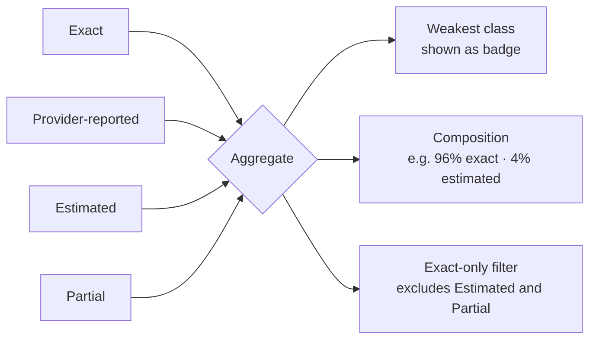

## Supported sources

The tiers below come from the research in [`docs/planning/00-research.md`](docs/planning/00-research.md). A tool appears as **Unsupported** when it exposes no trustworthy usage data that Veyra may read without credentials.

| Source | Interface | Data | Accuracy | Tier |
|---|---|---|---|---|
| Claude Code (CLI, desktop Code tab, IDE extension) | CLI / Desktop / IDE | Local JSONL session logs | Exact | MVP · **Available** ([details](docs/connectors/claude-code.md)) |
| Codex (CLI, IDE extension, desktop app) | CLI / IDE / Desktop | Local JSONL rollouts, plain or zstd-compressed | Exact | MVP · **Available** ([details](docs/connectors/codex.md)) |
| Gemini CLI | CLI | Local chat recordings (JSONL, or JSON before v0.39) | Exact (conversation requests only) | MVP · **Available** ([details](docs/connectors/gemini-cli.md)) |
| OpenCode | CLI | Local SQLite, read through a snapshot | Exact | MVP · **Available** ([details](docs/connectors/opencode.md)) |
| GitHub Copilot CLI | CLI | Local session events: totals per session and model | Provider-reported, per session | MVP · **Available** ([details](docs/connectors/copilot-cli.md)) |
| Claude Code / Codex / Gemini CLI / Copilot (VS Code) | Official OpenTelemetry (opt-in) | OTLP to a local receiver | Exact | Next |
| Claude Desktop Chat/Cowork, Aider, Cline, Roo Code | Desktop / CLI / IDE | Local files | Exact–Partial | Next |
| Ollama, LM Studio, OpenAI-compatible endpoints | Local runtime / API | Opt-in local capture proxy | Exact | Later |
| OpenRouter, OpenAI, Anthropic, xAI admin APIs | API | User-supplied keys, OS keyring | Provider-reported | Next |
| Cursor | IDE | Local database (estimates); Enterprise Admin API | Estimated / Provider-reported | Later |
| Windsurf, Antigravity, Zed, ChatGPT desktop | — | No usable local usage data | Unsupported | — |

## How it works

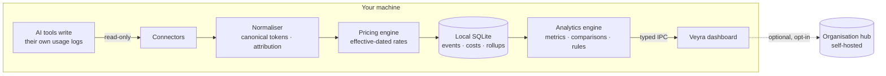

1. **Discover.** Veyra detects supported tools at their documented locations and registers them as disabled sources. It reads nothing until you enable a source.
2. **Collect.** Veyra reads only the new bytes of each log, from checkpoints committed together with the data, and connectors parse them. Source files are never locked, modified or deleted.
3. **Normalise.** One normaliser converts vendor-specific token semantics into canonical fields and separates provider, model, application, interface and gateway.
4. **Price.** Each event is priced using the rate that was in effect at that event's timestamp. Unknown models show "no price", never $0.
5. **Analyse.** SQL returns only additive sums. Every ratio, average and saving is derived in one Rust metric engine.
6. **Present.** The dashboard renders typed results. It contains no business logic.

## Architecture

Veyra is a **modular monolith with hexagonal boundaries**: one desktop process, with focused crates, inward-pointing dependencies and a single composition root. See [ADR-002](docs/adr/0002-modular-monolith-hexagonal.md).

### System context

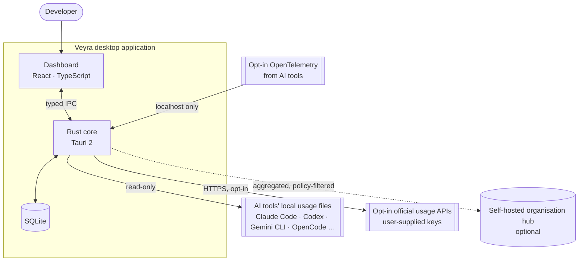

### Layered architecture

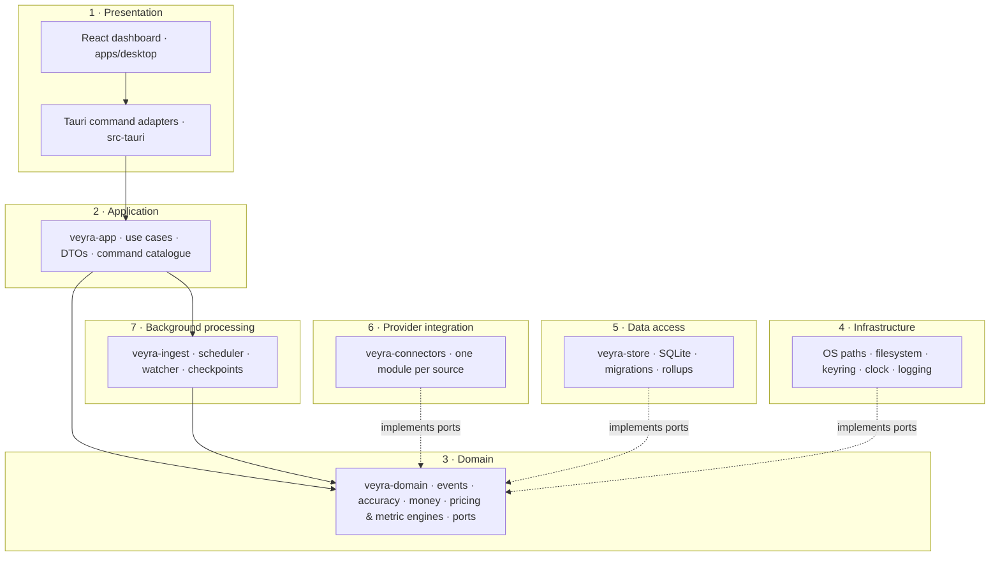

| Layer | Owns | Never does |
|---|---|---|
| Presentation | Routing, filter state, rendering, formatting | Calculate metrics or costs, parse sources, run SQL |
| Application | Use cases, DTO mapping, cross-port transactions | Contain SQL or file parsing |
| Domain | Business rules, pure engines, port traits | Perform I/O |
| Provider integration | Parsing source formats, declaring capabilities | Price, store or render |
| Data access | SQLite, migrations, repositories, rollups | Make business decisions |
| Background processing | Scheduling, watching, retries, cancellation | Know any specific source format |

### Backend (Rust core)

**Crate dependency graph.** Ports belong to their consumer:
- The analytics crate defines its read ports (sums, activity times, sessions, labels), and the store implements them.
- The domain defines `SourceRepository` and `IngestControl`, implemented by the store and the ingest worker.

The application layer therefore depends on the domain and the analytics engine only. The composition root (`src-tauri`) connects the store, the registry's display names and the ingest worker to it. `veyra-testkit` (synthetic fixtures, temporary directories) is a test-only dependency and is not shown.

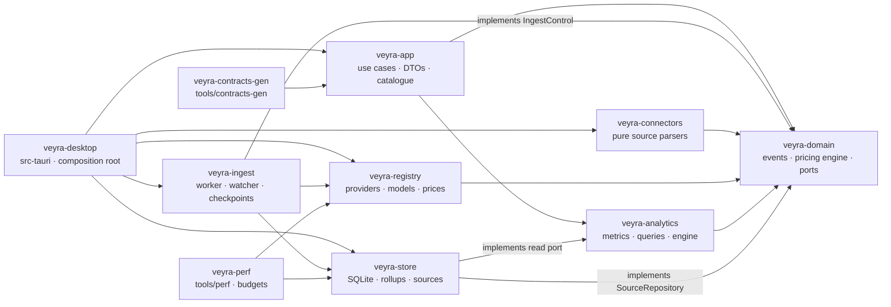

**IPC request flow (implemented).** Every command takes one typed `request` and returns a typed response or a typed `ApiError`. The Overview, for example:

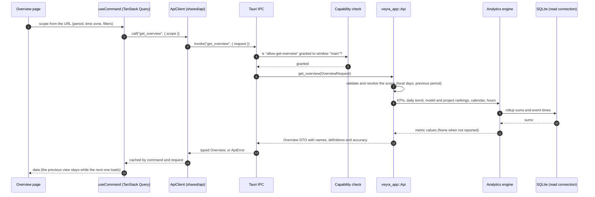

**Source lifecycle (implemented, M2).** Nothing under a source root is opened before consent ([ADR-023](docs/adr/0023-incremental-ingestion.md)).

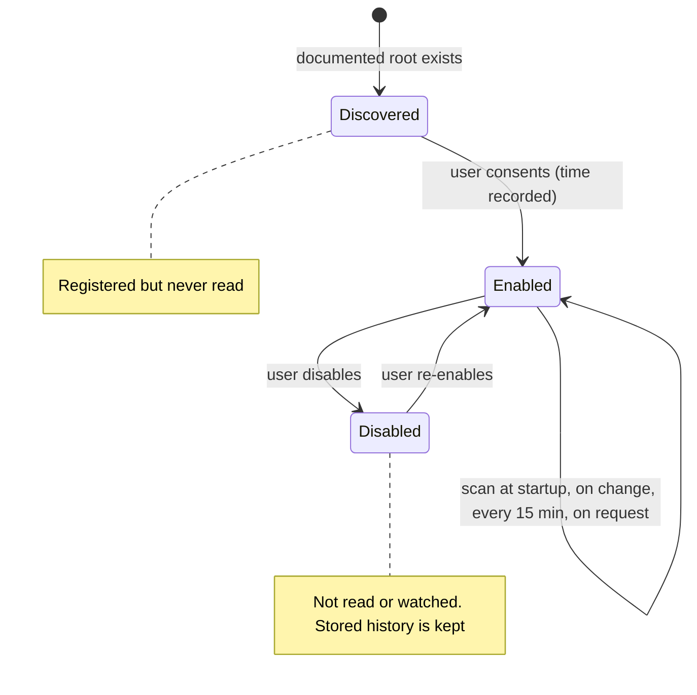

**Ingestion pipeline (implemented, M2).** It is crash-safe: events, costs, rollups, tool calls and the file checkpoint commit in one transaction. The file watcher is only a hint to scan sooner. Correctness comes from comparing each file with its checkpoint.

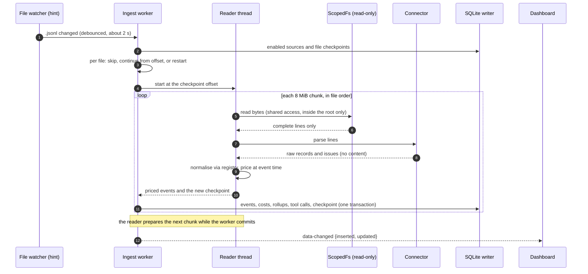

**Reading modes (implemented, M4).** Each connector declares how its files are read; connectors only parse ([ADR-025](docs/adr/0025-reading-modes-and-capabilities.md)).

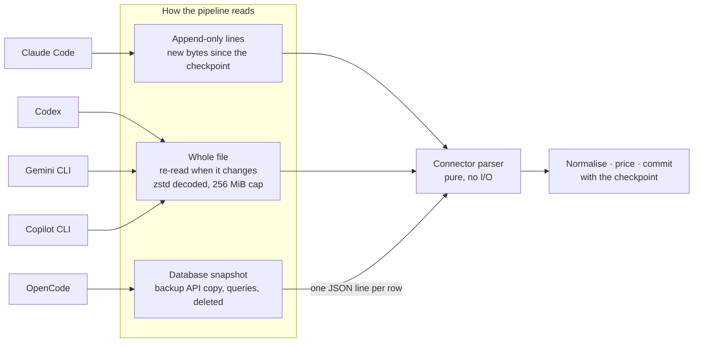

### Frontend (dashboard)

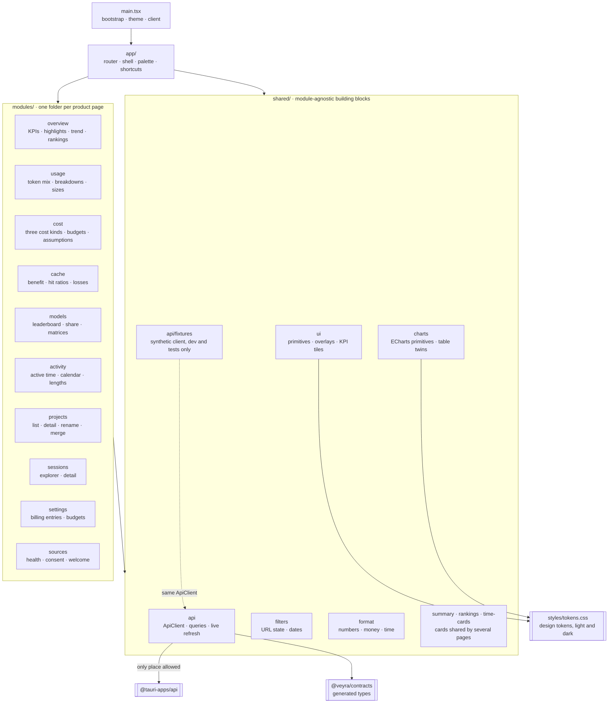

Lint-enforced rules (`veyra/module-boundaries`):

- `shared/` never imports `modules/` or `app/`.
- A module never imports another module.
- Only `shared/api` may import Tauri packages. The rest of the UI is transport-agnostic, so the same dashboard can later run over localhost HTTP or against an organisation hub.

**Data flow (implemented).** The core computes, names and defines every number; the dashboard selects and displays. Unknown values arrive as `null` and are shown as "—".

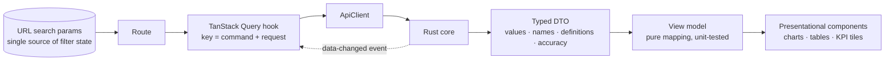

**First run (implemented, UC-01).** The privacy promise comes before any data is read.

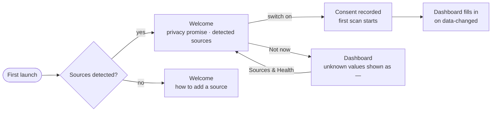

**Accessibility.** Every chart has an accessible name and a table twin. Every action is reachable by keyboard: `Ctrl K` opens the command palette, `g` followed by a letter opens a page, and `?` lists every shortcut. The data palette is validated for contrast and colour-blind separation. Playwright and axe check each page against WCAG 2.2 A/AA in both themes in CI.

### Command catalogue and generated contracts

One declaration drives three outputs, so the Rust core, the IPC permissions and the TypeScript types cannot drift apart. See [ADR-010](docs/adr/0010-generated-contracts.md).

The catalogue today:
- **Commands:**
  - `get_app_info`
  - `list_sources`, `set_source_enabled`, `request_rescan`
  - `get_overview`, `list_sessions`, `get_session`
- **Events** (core to dashboard, declared in `for_each_event!`): `data-changed`.

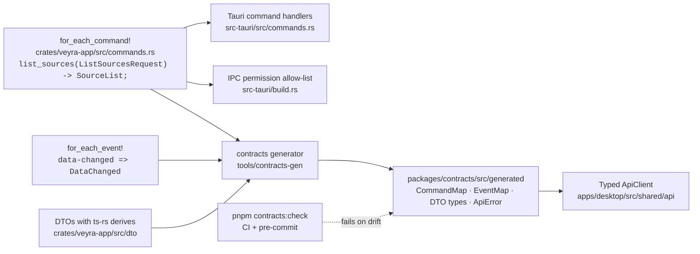

### Data model

Implemented in migration 0001 (M1). Unavailable values are stored as `NULL`, never `0`. Money is stored as integer nano-USD. Prices are not in the database: they come from the version-controlled registry, and every stored cost records the catalogue version and rule that produced it.

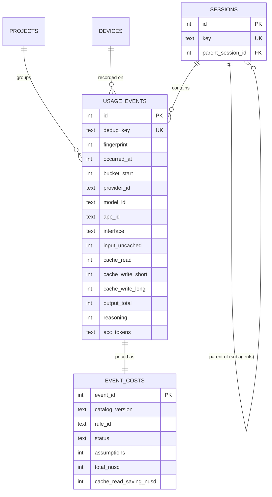

**Ingestion tables (migrations 0002–0003, M2).** Sources record consent, and file checkpoints record how far each log has been read. Runs and issues are counted diagnostics; no content is stored. Tool calls keep ids, names and outcomes only, keyed by their tool-use id.

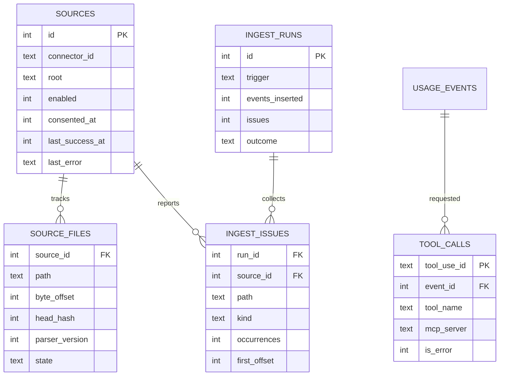

**Rollups.** Events are aggregated into levels of 15-minute UTC buckets, all clustered by time and all rebuilt in the same transaction as each write. Every real-world UTC offset is a multiple of 15 minutes, so local days, hours and weeks stay exact in zones like Asia/Kolkata (+05:30). See [ADR-009](docs/adr/0009-fifteen-minute-utc-rollups.md) and [ADR-022](docs/adr/0022-data-core-implementation.md).

- **Sums:** totals, one dimension, services (provider, model, application, interface) and every combination.
- **Page rollups** ([ADR-030](docs/adr/0030-page-rollups.md)): session spans and sums, pricing outcomes, and request-size bins. Raw events stay the exact fallback whenever a rollup cannot answer exactly.

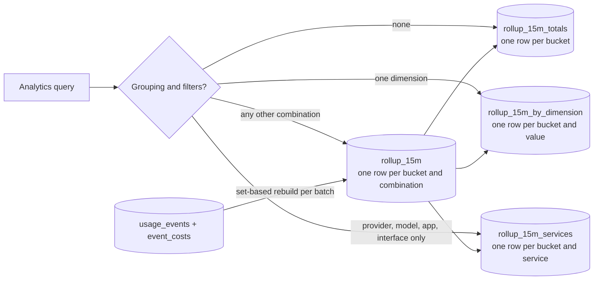

**Reads sized to each card** ([ADR-031](docs/adr/0031-reads-sized-to-each-card.md)):

- **Daily and hourly series** are summed per local day or hour in SQL, so a 30-day series returns one row per day rather than one per 15 minutes.
- **Cards that show one sum** (the activity calendar, the hour-of-week grid, model matrices, each project's top model, the Cost waterfalls) read only total tokens or only API-equivalent cost.
- **Readers** map the database file into memory and keep every page's statements prepared.

Tests compare every specialised read with the full sums.

### Pricing and cost model

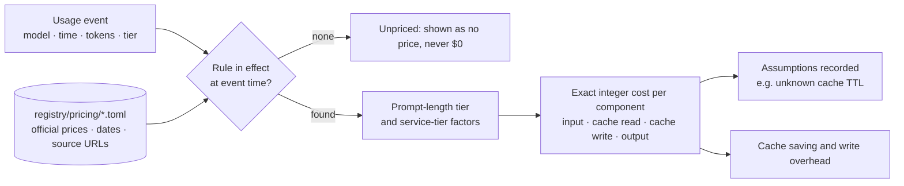

- **Three cost kinds, never added together.** API-equivalent estimates, actual charges and subscription spend are distinct types; the code cannot add one to another.
- **Historical accuracy.** Each event is priced with the rule in effect at its timestamp, so scheduled changes (for example Gemini 4 Argon on 2026-12-01) and promotional end dates apply on their dates.
- **Catalogue 2026-11-08.1.** It covers Anthropic (19 models), OpenAI (14) and Google (10), including:
  - long-context tiers;
  - batch, flex, priority, fast and ultrafast pricing;
  - Anthropic's US-only inference multiplier.

  Every rule names its official source page. Updating prices is a reviewed pull request ([CONTRIBUTING](CONTRIBUTING.md#updating-prices)).

### Performance

Overview queries, measured with `veyra-perf` on one million synthetic events (a realistic year of sessions):

| Overview query | p95, developer machine | p95, CI runners (4 runs) | Budget |
|---|---|---|---|
| 30-day daily trend by application, with comparison | 76 ms | 26–52 ms | 150 ms |
| 30-day model ranking (top 8 + other) | 51 ms | 21–42 ms | 150 ms |
| 12-month trend | 81 ms | 32–68 ms | 150 ms |

Dashboard pages: the command behind each page, called as the desktop shell calls it, over the last 30 days with comparison. Measured on a two-core CI runner on 2026-11-12 ([ADR-029](docs/adr/0029-page-reads-in-parallel.md), [ADR-031](docs/adr/0031-reads-sized-to-each-card.md)):

| Page | p95, 1M events | p95, 10M events |
|---|---|---|
| Overview | 96 ms | 330 ms |
| Usage | 91 ms | 221 ms |
| Cost | 85 ms | 241 ms |
| Cost assumptions | 10 ms | 14 ms |
| Cache | 83 ms | 295 ms |
| Models & Providers | 77 ms | 164 ms |
| Activity | 29 ms | 172 ms |
| Projects | 38 ms | 224 ms |
| Sessions (first page) | 5 ms | 50 ms |
| **Budget** | **150 ms** | **400 ms** |

Ingestion:

| Measurement | Developer machine | CI runners | Budget (CI) |
|---|---|---|---|
| End to end: one large Claude Code log, read → parse → price → commit | about 50,000–60,000 events/s | 39,000–49,000 events/s per attempt (best of three: 41,400–48,900) | ≥ 35,000 events/s, best of three |
| Store writes alone, one million synthetic events | about 35,000 events/s | 34,000–43,000 events/s | — |
| Real backfill: 249 logs, 1.3 GB, 38,509 requests | 8.9 s | — | — |
| Rescan with nothing new | 0.2 s, no writes | — | — |

GitHub-hosted runners vary by up to about 20% between runs. The ingest budget takes the best of three attempts and sits about 15% below the slowest best-of-three result measured (41,400 events/s), matching that variance, so it fails on real regressions rather than on slow hardware. The `Performance` workflow checks the query, page and ingest budgets weekly and on demand. After a backfill the worker blocks until the next change, so idle CPU is zero.

## Privacy and security

| Veyra reads | Veyra never reads or stores |
|---|---|
| Timestamps, model identifiers, token counts | Prompts, responses or conversation text |
| Session and request identifiers | Source code or file contents |
| Working directory and git branch name (for project attribution) | Tool-call arguments or outputs |
| Tool *names* and categories | Other apps' credentials, keychains, cookie stores |
| Cost figures reported by the tool itself | Environment variables other than documented location overrides |

**Security model (implemented in M0).**

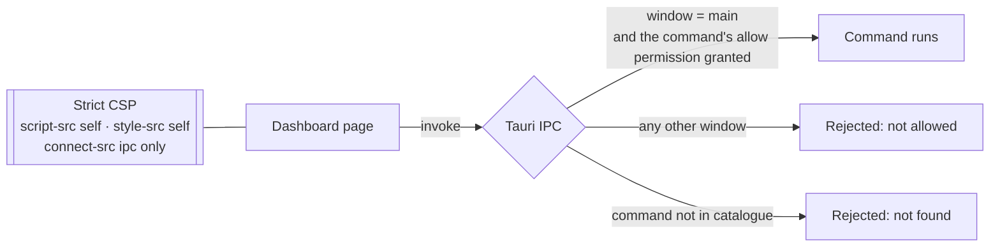

- **IPC permissions.** IPC is limited to the commands declared in the catalogue, and only the `main` window may call them. This is verified by the integration tests in [`src-tauri/tests/ipc_access.rs`](src-tauri/tests/ipc_access.rs).
- **Safe ingestion (M2, [ADR-023](docs/adr/0023-incremental-ingestion.md)).**
  - **Consent and scope.** Sources stay disabled until you enable them. Reads are confined to the source root: no `..`, no absolute paths, no symbolic links. Credential and key files are refused by name, even inside a root.
  - **Read-only, shared access.** Files are opened read-only and shared, so the tool can keep writing, renaming and deleting its logs. A test renames and deletes a file while Veyra holds it open.
  - **No content is parsed.** Connectors deserialise only usage fields and tool *names*. Text is skipped without being buffered.
  - **Canary checks.** Fixtures and a real-data check place canary strings wherever logs hold content. The database, its WAL and shared-memory files must contain none.
- **Content Security Policy.** The production CSP allows no `unsafe-inline` and no `unsafe-eval`. This was verified on a built app through WebView2 DevTools.
- **Plugins.** No shell plugin, no SQL plugin and no global Tauri object. The JavaScript prototype is frozen.
- **No telemetry.** Network access happens only through features you explicitly enable.
- **Supply chain.** Exact version pins, a 7-day minimum release age, dependency install scripts disabled, GitHub Actions pinned to commit SHAs, and cargo-deny plus `pnpm audit` in CI. CodeQL and dependency review return when the repository becomes public ([ADR-021](docs/adr/0021-ci-scope-while-private.md)). See [ADR-017](docs/adr/0017-supply-chain-policy.md).

## Technology stack

| Layer | Technology | Why |
|---|---|---|
| Desktop shell | **Tauri 2.12** | System webview: small installers, low memory, capability-based IPC security |
| Core | **Rust 1.99** (edition 2024) | Memory safety, low footprint, excellent SQLite and filesystem libraries |
| Storage | **SQLite** via rusqlite (bundled) | Embedded and zero-ops, with WAL for safe concurrent reads |
| UI | **React 19.3** + **TypeScript 6.0** (strict) | Mature ecosystem; strict typing end to end |
| Build | **Vite 8.3** | Fast, Tauri-native |
| Contracts | **ts-rs 12** + command catalogue macro | Rust is the single source of truth for every IPC type |
| Charts | **Apache ECharts 6** (tree-shaken) | One library for calendar, heatmap, treemap, sankey and large datasets |
| Data fetching / routing | **TanStack Query 5** and **TanStack Router 1** | Cached results refreshed by core events; the URL as the single source of filter state |
| Design system | **Tailwind CSS 4** over design tokens, **Radix** primitives, lucide icons, Inter and JetBrains Mono (bundled) | Accessible behaviour without imposed styling; one token file for both themes |
| Quality | ESLint 10 + typescript-eslint (strict, type-aware), Prettier, rustfmt, clippy, Vitest, Playwright + axe | Enforced in CI and pre-commit |
| Supply chain | pnpm 12 (release-age gate), cargo-deny, pnpm audit | Defence against compromised dependencies |

Every choice and its rejected alternatives are recorded in the [architecture decision records](docs/adr/README.md).

## Repository structure

```text
veyra/
├── apps/
│   └── desktop/                 # React + TypeScript dashboard (Vite)
│       ├── e2e/                 # Playwright + axe UI tests on the fixture client
│       └── src/
│           ├── app/             # router, shell (sidebar, header, query bar, palette), theme
│           ├── modules/         # one folder per page (overview, usage, cost, cache, …)
│           ├── shared/          # module-agnostic building blocks
│           │   ├── api/         # ApiClient, Tauri transport, queries, synthetic fixture client
│           │   ├── charts/      # ECharts primitives and their table twins
│           │   ├── filters/     # URL filter state, dates
│           │   ├── format/      # numbers, money, durations, measures
│           │   ├── summary/     # cards shared by several pages (also rankings/, time-cards/, links/)
│           │   └── ui/          # design-system primitives, overlays, KPI tiles
│           └── styles/          # design tokens (light, dark) and base styles
├── packages/
│   └── contracts/               # GENERATED TypeScript contracts (never edit)
├── crates/
│   ├── veyra-domain/            # pure domain: events, tokens, accuracy, money, pricing engine
│   ├── veyra-registry/          # loads + validates registry/*.toml (single source of truth)
│   ├── veyra-analytics/         # metric registry, query specs, time-zone-aware engine
│   ├── veyra-store/             # SQLite: migrations, idempotent writes, rollups, sources, checkpoints
│   ├── veyra-connectors/        # pure source parsers: Claude Code, Codex, Gemini CLI, OpenCode, Copilot CLI
│   ├── veyra-ingest/            # discovery, scoped reads, whole files, SQLite snapshots, pipeline, worker
│   ├── veyra-app/               # application layer: Api, page views, DTOs, display names, catalogues
│   └── veyra-testkit/           # test-only: synthetic fixture paths, temporary directories
├── src-tauri/                   # Tauri shell: composition root, commands, capabilities
│   ├── capabilities/            # IPC permission grants
│   └── tests/                   # IPC access-control integration tests
├── tests/
│   └── fixtures/                # synthetic connector fixtures with canary markers
├── registry/                    # providers, models and official prices (TOML, reviewed by PR)
├── tools/
│   ├── contracts-gen/           # generates packages/contracts from Rust
│   └── perf/                    # synthetic dataset + performance budget check
├── tooling/
│   ├── eslint/                  # custom module-boundaries lint rule + tests
│   ├── csp/                     # serves a build with the production CSP for UI tests
│   └── palette/                 # data-palette validator (contrast, separation, colour blindness)
├── docs/
│   ├── planning/                # research, PRD, architecture, UX, risks, roadmap
│   ├── connectors/              # one page per connector: paths, fields, mapping rules
│   └── adr/                     # architecture decision records 0001–0025
├── .github/workflows/           # CI and security pipelines
└── .githooks/                   # pre-commit checks
```

## Getting started

### Prerequisites

| Requirement | Version | Notes |
|---|---|---|
| Node.js | ≥ 22.12 | |
| pnpm | 12.17.0 | `npm i -g pnpm@12.17.0`, or Corepack |
| Rust | pinned in `rust-toolchain.toml` | Install [rustup](https://rustup.rs); the toolchain installs automatically |
| Windows | Visual Studio Build Tools (C++ workload), WebView2 | WebView2 ships with Windows 11 |
| macOS | Xcode Command Line Tools | `xcode-select --install` |
| Linux | WebKitGTK 4.1 and build essentials | See [Tauri prerequisites](https://v2.tauri.app/start/prerequisites/) |

### Install and run

```bash
pnpm install
```

```bash
pnpm hooks:install
```

```bash
pnpm dev
```

`pnpm dev` starts the Vite dev server on `127.0.0.1:1420` and opens the desktop window with hot reload.

### Build

```bash
pnpm build
```

## Development

| Command | Purpose |
|---|---|
| `pnpm dev` | Run the desktop app with hot reload |
| `pnpm build` | Build the production app and installers |
| `pnpm check` | Run everything CI runs (below) |
| `pnpm lint` / `pnpm lint:rust` | ESLint (type-aware) / clippy with warnings as errors |
| `pnpm typecheck` | Strict TypeScript across all packages |
| `pnpm test` / `pnpm test:rust` | Vitest / Rust unit and integration tests |
| `pnpm format` / `pnpm format:check` | Prettier and rustfmt |
| `pnpm contracts:generate` | Regenerate TypeScript contracts after changing Rust DTOs or commands |
| `pnpm contracts:check` | Fail if the generated contracts are out of date |
| `pnpm palette:check` | Validate the chart data palette in both themes (also part of `pnpm test`) |
| `pnpm --filter @veyra/desktop dev` | Run the dashboard alone in a browser on synthetic data (add `?fresh` to the URL for a first run) |
| `pnpm --filter @veyra/desktop test:ui` | Playwright + axe UI tests (set `PLAYWRIGHT_CHANNEL=msedge` or `chrome` to use an installed browser) |
| `cargo run --release -p veyra-ingest --example scan_root -- <dir> <new-db>` | Ingest a local Claude Code `projects` directory into a scratch database and print counts only |

### Adding a command

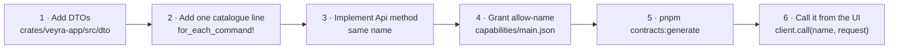

The compiler, the IPC access tests and the contract drift check catch any missed step.

## Testing strategy

| Level | What it covers | Tooling |
|---|---|---|
| Unit | Domain invariants, pricing (hand-derived values), metrics, time zones, use cases, API client, lint rules | `cargo test`, Vitest |
| Pricing data | Published prices reproduced exactly through the engine (tiers, scheduled changes, re-routes) | `cargo test` (`veyra-registry`) |
| Storage | Idempotency, moved events, rollups equal raw events on random data, all rollup levels agree, re-pricing, backups | `cargo test` (`veyra-store`) |
| Integration | IPC access control against a mock Tauri runtime, with the real configuration | `cargo test` (`src-tauri/tests`) |
| Contract | Generated TypeScript matches Rust DTOs and the command catalogue | `pnpm contracts:check` |
| Parser | Each connector and format version: synthetic fixtures → expected records, field by field; only allow-listed files are read; no content leaves the parser; running totals add up to the final total and resets start a new baseline (Codex); session summaries count once (Copilot CLI) | `cargo test` (`veyra-connectors`) |
| Connectors end to end | Discovery, consent, totals, idempotent rescans and no stored content for every connector; compressed copies add nothing; a live SQLite database is never locked while a writer keeps writing; Claude through Copilot attributes vendor, gateway and application separately | `cargo test` (`veyra-ingest/tests/connectors.rs`) |
| Ingestion | Consent, idempotent rescans, appends, partial lines, truncation, replacement, deletion, oversize lines, cancellation, concurrent writers, shared access, canaries, the watcher | `cargo test` (`veyra-ingest`) |
| Performance | Overview query and dashboard page budgets on 1M and 10M synthetic events; end-to-end ingest throughput | `veyra-perf`, ignored throughput test, `Performance` workflow |
| Page contract | Overview equals the metric engine for the same scope; parts add up to the headline; sessions sum to the Overview; one name per model across pages | `cargo test` (`veyra-app/tests/contract.rs`) |
| View models | Pure mappings from DTOs to chart inputs, filter options, URL state, formatting, the data palette | Vitest |
| UI | First-run consent (UC-01), keyboard-only session journey (UC-02), filter state with Back and Forward, WCAG 2.2 A/AA in both themes | Playwright + axe on the synthetic fixture client |
| Production CSP | The production build served with the policy of `tauri.conf.json` (and per-load style nonces, as in Tauri): every page, overlay and tooltip without a violation | Playwright, `tooling/csp` |
| Bundle smoke (M8) | The built app on all three OSes | WebdriverIO (planned) |

Test data is always synthetic. Real transcripts or credentials are never committed.

## Continuous integration

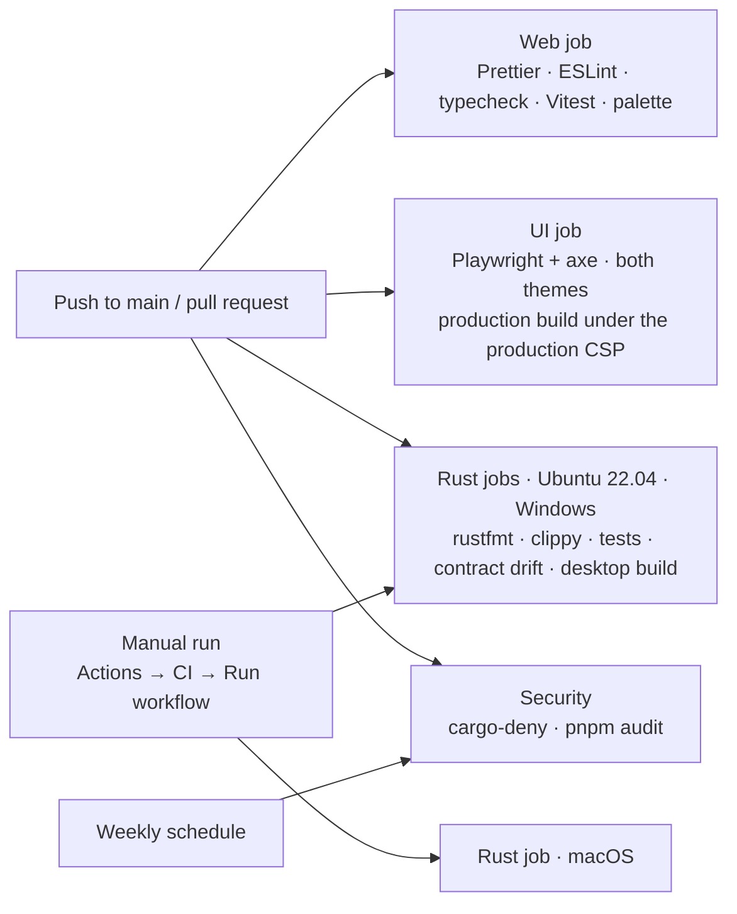

- All actions are pinned to full commit SHAs, with read-only permissions by default.
- While the repository is private, macOS builds run only on manual dispatch, because macOS minutes are billed at 10×. CodeQL and dependency review are off, because they require GitHub Advanced Security on private repositories.
- Both come back when the repository is made public. See [ADR-021](docs/adr/0021-ci-scope-while-private.md).

## Roadmap

```mermaid
flowchart LR
  M0[M0 Foundations<br/>✅ complete]:::done --> M1[M1 Data core<br/>✅ complete]:::done
  M1 --> M2[M2 Claude Code<br/>end-to-end ingestion<br/>✅ complete]:::done
  M2 --> M3[M3 Dashboard shell<br/>design system<br/>✅ complete]:::done
  M2 --> M4[M4 Codex · Gemini CLI<br/>OpenCode · Copilot CLI<br/>✅ complete]:::done
  M3 --> M5[M5 Analytics modules<br/>✅ complete]:::done
  M4 --> M5
  M5 --> M6[M6 Exports · Storage<br/>Settings]
  M5 --> M7[M7 Tools & Agents · Quotas<br/>Optimization · OTLP]
  M6 --> M8[M8 Release v1.0]
  M7 --> M8
  M8 --> M9[M9 More connectors<br/>localhost access]
  M9 --> M10[M10 Organisation hub]
  classDef done fill:#d1f7d6,stroke:#2f9e44
```

| Release | Contents |
|---|---|
| 0.1 (internal alpha) | M0–M3: Claude Code, Overview, Sessions, Sources |
| 0.5 (public beta) | All MVP connectors and analytics modules, exports |
| 1.0 | Tools & Agents, Quotas, Optimization, OpenTelemetry receiver, installers, updater |
| 2.0 | Self-hosted organisation hub |

The detailed, dependency-ordered plan with acceptance criteria is in [`docs/planning/05-roadmap.md`](docs/planning/05-roadmap.md).

## Documentation

| Document | Contents |
|---|---|
| [Planning package](docs/planning/README.md) | Overview, approved decisions |
| [Research](docs/planning/00-research.md) | Reference-project comparison, source-coverage matrix, stack and pricing research |
| [Product requirements](docs/planning/01-prd.md) | Users, use cases, requirements, metric definitions, acceptance criteria |
| [Architecture](docs/planning/02-architecture.md) | Stack, layers, contracts, schema, pricing and analytics engines, threat model |
| [UX plan](docs/planning/03-ux.md) | Sitemap, page anatomy, chart choices, design system, accessibility |
| [Feasibility and risks](docs/planning/04-feasibility-risks.md) | Feasibility, risk register, hidden costs, prioritisation |
| [Roadmap](docs/planning/05-roadmap.md) | Milestones, tasks, acceptance criteria |
| Connectors: [Claude Code](docs/connectors/claude-code.md), [Codex](docs/connectors/codex.md), [Gemini CLI](docs/connectors/gemini-cli.md), [OpenCode](docs/connectors/opencode.md), [GitHub Copilot CLI](docs/connectors/copilot-cli.md) | Per-source paths, fields used, mapping rules, precedence and known gaps |
| [Decision records](docs/adr/README.md) | ADR 0001–0023 |

## Author

**Nikunj Bansal**: creator and maintainer of Veyra.

## Contributing

Contributions are welcome. Please read [CONTRIBUTING.md](CONTRIBUTING.md) for the engineering standards, the module rules, the dependency admission checklist and the pull-request process, and follow the [Code of Conduct](CODE_OF_CONDUCT.md).

## Security policy

Please report vulnerabilities privately. See [SECURITY.md](SECURITY.md).

## License

Licensed under either of

- Apache License, Version 2.0 ([LICENSE-APACHE](LICENSE-APACHE))
- MIT License ([LICENSE-MIT](LICENSE-MIT))

at your option. Unless you explicitly state otherwise, any contribution intentionally submitted for inclusion in Veyra is dual-licensed as above, without additional terms or conditions.
