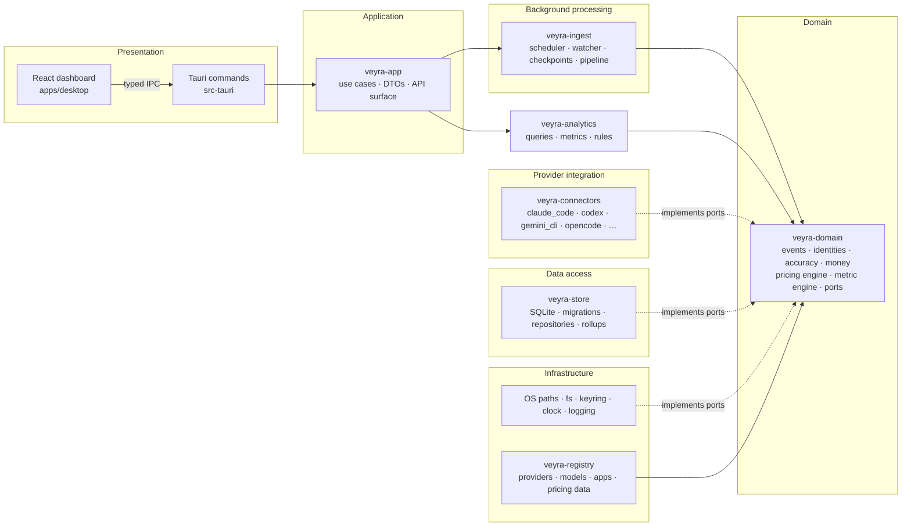
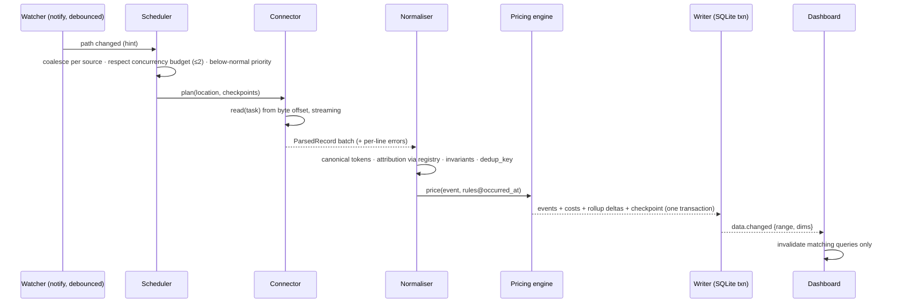
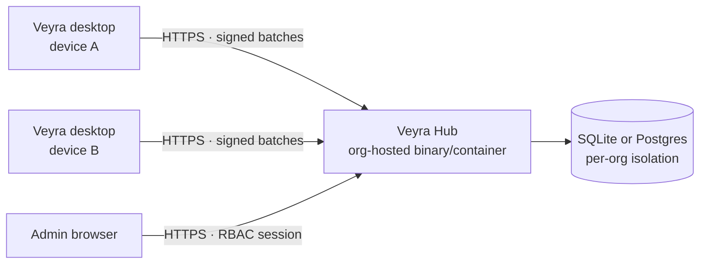

# Phase 2 — Architecture and Technical Plan

## 1. Architectural style

**A modular monolith with hexagonal boundaries.** There is one desktop process. The Rust core is a Cargo workspace of focused crates, and the React dashboard is the presentation layer.

- **Dependencies point inwards.** The domain depends on nothing. Adapters (connectors, SQLite, OS, Tauri) depend on domain-defined ports.
- **One composition root** (`src-tauri`) wires the adapters together.
- **Extracting a service later is cheap.** The Hub reuses `veyra-domain`, `veyra-store` and `veyra-analytics` unchanged; only the transport differs. No microservices, queues or containers are needed for the desktop app.



### Layer responsibilities and contracts

| # | Layer | Owns | Must not | Contract to the next layer |
|---|---|---|---|---|
| 1 | **Presentation** (`apps/desktop`, `src-tauri/commands`) | Routing, filter state, rendering, formatting, user interaction. Tauri command handlers are 1–5 line adapters | Calculate metrics or costs, parse sources, touch SQL | Generated TS request/response types; `ApiError` union |
| 2 | **Application** (`veyra-app`) | Use cases (`GetOverview`, `ListSessions`, `RescanSource`, `ExportReport`…), DTO mapping, authorisation of operations, transactions across ports | Contain SQL or file parsing | `Api` facade with one method per use case |
| 3 | **Domain** (`veyra-domain`) | Entities and value objects (UsageEvent, TokenCounts, Accuracy, Money, ModelId…), pure engines (normalisation rules, pricing, metric derivation, accuracy propagation), **port traits** | Perform I/O, use time or randomness directly (`Clock` and `IdGen` are ports) | Rust types and traits |
| 4 | **Infrastructure** (`src-tauri/infra`, small modules) | OS directories, keyring, clock, logging setup, process priority | Business rules | Implements domain ports |
| 5 | **Data access** (`veyra-store`) | SQLite connection management, migrations, repositories, rollup maintenance, backups | Business decisions beyond persistence | Implements `UsageRepository`, `CheckpointStore`, `AnalyticsReader`… |
| 6 | **Provider integration** (`veyra-connectors`) | Discovering and parsing source formats into `ParsedRecord`s, declaring capabilities | Pricing, storage, UI, network calls (local connectors) | `SourceConnector` trait |
| 7 | **Background processing** (`veyra-ingest`) | Scheduling, watching, checkpoint progression, pipeline (parse → normalise → validate → upsert → price → roll up), retry/backoff, cancellation | Know any specific source format | `IngestService` API + progress events |

`veyra-analytics` belongs to the application/domain side. It defines query specifications, the metric registry and the recommendation rules. It reads additive sums through the `AnalyticsReader` port and computes every derived metric in Rust, which is the single source of truth.

## 2. Technology stack

Versions were verified on 2026-11-08 (npm registry, crates.io API, GitHub API). They are pinned exactly in M0 and re-verified then.

### 2.1 Selected stack

| Layer | Choice | Version | Licence | Why | Rejected alternatives |
|---|---|---|---|---|---|
| Desktop shell | **Tauri 2** | 2.12.5 (CLI 2.12.4) | Apache-2.0/MIT | System webview → small installers and low RAM. Capability-based IPC permissions. Signed updater. Mature (about 112k stars) | Electron 45 (heavier, ships Chromium); Wails v3 (Go backend); Electrobun (young); Neutralino (weak security/updater); Tauri 3 (alpha) |
| Native core | **Rust** stable (pin via `rust-toolchain.toml`, edition 2024) | current stable at M0 | — | Memory safety, low footprint, excellent SQLite/fs crates, `#![forbid(unsafe_code)]` in our crates | — |
| Database | **SQLite** via **rusqlite** (`bundled`) | 0.41.1 | MIT | Embedded, zero-ops, WAL, mature. Synchronous API suits a single-user app | sqlx (async-first, compile-time DB checks), diesel (four SQLite advisories in 2026), SeaORM (needless abstraction), DuckDB (held back as an optional analysis engine; large binary) |
| Migrations | **rusqlite_migration** | 2.6.0 | Apache-2.0 | Lightweight, uses `user_version` | refinery 0.10 (fine; more machinery) |
| Async runtime | **tokio** | 1.54.1 | MIT | Already used by Tauri | — |
| File watching | **notify** (+ debouncer) | 8.2.1 | CC0-1.0 | Cross-platform standard; used as a *hint* followed by reconciliation | notify 9 RC (not stable) |
| Serialisation | **serde / serde_json** | 1.0.229 / 1.0.154 | MIT/Apache | Standard | — |
| Errors | **thiserror** (libraries) + **anyhow** (composition root only) | 2.0.21 / 1.0.104 | MIT/Apache | Explicit typed errors at boundaries | — |
| Logging | **tracing** + tracing-subscriber, rolling file | 0.1.44 | MIT | Structured, filterable. A redaction layer is applied | log/env_logger |
| Secrets (later) | **keyring** | 4.2.0 | MIT/Apache | Windows Credential Manager / macOS Keychain / Secret Service | Stronghold plugin (heavier); plain files |
| Rust→TS types | **ts-rs** | 12.0.1 | MIT | Stable; generates TS from Rust DTOs (single source) | specta/tauri-specta (no stable 2.x; revisit) |
| UI framework | **React** + React Compiler | 19.3.1 / compiler 1.0.0 | MIT | Ecosystem, hiring pool, stable compiler reduces hand-memoisation | Svelte/Solid (smaller ecosystems for charts/tables/a11y) |
| Language | **TypeScript 6.0.3** (strict) | 6.0.3 | Apache-2.0 | Last JS-based line; fully supported by typescript-eslint. **TS 7.0.2 released today**: adopt when the lint ecosystem supports it (ADR-012) | TS 7 now (unsupported by typescript-eslint) |
| Build | **Vite** + `@vitejs/plugin-react` | 8.3.6 / 6.2.1 | MIT | Fast, Tauri-native | — |
| Routing | **TanStack Router** | 1.170.x (exact pin) | MIT | **Type-safe, validated search params**: the global filter model lives in the URL with no hand-written parsing | React Router 8 (good; less typed search-param support) |
| Data fetching / cache | **TanStack Query** | 5.107.1 | MIT | Caching, deduplication, invalidation on backend "data changed" events, cancellation | Hand-rolled cache; SWR |
| Client state | **None initially** (URL + Query + React state) | — | — | YAGNI: filters live in the URL, server data in Query, preferences in the backend | Zustand (add only if a real need appears) |
| Styling | **Tailwind CSS 4** (CSS-first `@theme` tokens) | 4.3.5 | MIT | Tokens defined once in CSS and read by charts too | CSS-in-JS (runtime cost) |
| Components | **Radix primitives via shadcn** (code copied and owned) | radix-ui 1.8.1 | MIT | Accessible primitives; no runtime UI-kit lock-in | MUI/Ant (heavy, opinionated) |
| Charts | **Apache ECharts** (tree-shaken `echarts/core`) | 6.1.0 | Apache-2.0 | One library covers line/area/bar/stacked/heatmap/**calendar**/treemap/sankey/scatter/boxplot, canvas rendering, large-data modes | Recharts (no calendar/sankey quality), Nivo (stale, SVG), visx/D3 (build everything), uPlot (time series only) |
| Tables | **TanStack Table + Virtual** | 9.3.1 / 3.14.26 | MIT | Headless, virtualised; 100k-row tables | AG Grid (licence/size) |
| Unit tests (TS) | **Vitest** + Testing Library | 5.1.0 | MIT | Vite-native | Jest |
| UI E2E | **Playwright** against Vite with mocked IPC | 1.65.0 | Apache-2.0 | Fast, deterministic UI flows | — |
| Shell E2E | **WebdriverIO + @wdio/tauri-service** | 1.5.1 | MIT | Smoke tests on the real bundle on all three OSes (`tauri-driver` lacks macOS) | CrabNebula driver (paid on macOS) |
| Lint / format (TS) | **ESLint 10** flat config + **typescript-eslint** `strict-type-checked` + **Prettier** | 10.14.0 / 8.72.1 / 3.9.10 | MIT | Type-aware rules (`no-floating-promises`, `no-unsafe-*`), module-boundary rules | Biome/oxlint (fast, but weaker type-aware linting; revisit with TS 7) |
| Lint / format (Rust) | rustfmt, clippy (`-D warnings`, selected pedantic lints) | toolchain | — | Standard | — |
| Supply chain | **cargo-deny**, **cargo-audit**, `pnpm audit`, CycloneDX SBOM (`@cyclonedx/cyclonedx-npm` 6.0.1, `cargo-cyclonedx`†) | 0.20.2 / 0.22.2 | MIT/Apache | Licence policy, advisories, bans, SBOM | — |
| Package manager | **pnpm** workspaces (via Corepack) | 12.18.0 | MIT | Strict dependency graph, `minimumReleaseAge`, scripts disabled by default | npm |
| CI / release | GitHub Actions + GitHub Releases | — | — | Free for public repositories; 3-OS matrix | — |

† Marks a tool to verify (version and licence) at the milestone that adds it. Candidates still to evaluate: `rust_xlsxwriter` (XLSX export), `proptest`, `insta` (snapshot tests), `lefthook` (git hooks), `dependency-cruiser` (TS cycle checks), `tokio-util` (cancellation tokens). None is added without the supply-chain checklist (§12.3).

### 2.2 Things deliberately **not** used

- No Next.js, server runtime, cloud database, Redis or queue service.
- Not `tauri-plugin-sql`: it exposes SQL to the webview, an unnecessary attack surface.
- Not `tauri-plugin-shell`: Veyra executes no external binaries.
- No second chart library and no D3 until a visualisation genuinely needs custom layout. Calendar and heatmap are native ECharts series.
- No web fonts fetched at runtime. Inter and JetBrains Mono (OFL) are bundled locally.

## 3. Repository and directory structure

```
veyra/
├─ apps/
│  └─ desktop/                       # the one dashboard (served via Tauri; later via localhost/Hub)
│     ├─ index.html
│     ├─ src/
│     │  ├─ app/                     # bootstrap, router tree, providers, shell layout, error boundary
│     │  ├─ modules/                 # one folder per product module; modules never import each other
│     │  │  ├─ overview/
│     │  │  │  ├─ overview.route.tsx       # route + search-param schema reference
│     │  │  │  ├─ overview.queries.ts      # TanStack Query hooks → api client
│     │  │  │  ├─ overview.view-model.ts   # pure DTO → display mapping (unit tested)
│     │  │  │  └─ components/              # presentational, page-specific
│     │  │  ├─ usage/ cost/ cache/ models/ tools/ projects/ sessions/ activity/
│     │  │  └─ quotas/ optimization/ storage/ sources/ organization/ settings/
│     │  ├─ shared/                  # reusable, module-agnostic building blocks
│     │  │  ├─ api/                  # Transport interface, tauri/http transports, typed client
│     │  │  ├─ filters/              # global filter model, URL codec, FilterBar, chips
│     │  │  ├─ charts/               # EChart runtime, theme-from-tokens, chart primitives (Trend, Composition, Ranking, Calendar, Heatmap…)
│     │  │  ├─ data-table/           # DataTable (TanStack Table + Virtual), column helpers
│     │  │  ├─ ui/                   # design-system components (shadcn-owned)
│     │  │  ├─ metrics/              # MetricValue, KpiTile, DeltaChip, definitions lookup
│     │  │  ├─ accuracy/             # AccuracyBadge, CoverageMeter
│     │  │  └─ format/               # numbers, money, tokens, durations, dates, percent — single source
│     │  └─ styles/
│     │     └─ tokens.css            # design tokens (Tailwind @theme) — single source for CSS + charts
│     └─ tests/                      # Playwright UI flows with IPC mock fixtures
├─ packages/
│  └─ contracts/                     # GENERATED TS types + command map from Rust (never hand-edited)
├─ crates/
│  ├─ veyra-domain/                  # pure domain + ports (no I/O)
│  │  └─ src/{identity,event,tokens,accuracy,money,pricing,metrics,tooling,session,ports}/
│  ├─ veyra-registry/                # loads + validates /registry data; compiled in via include_str!
│  ├─ veyra-connectors/              # one module per source; shared parsing helpers
│  │  └─ src/{claude_code,codex,gemini_cli,opencode,copilot_cli,…,common}/
│  ├─ veyra-ingest/                  # discovery, scheduler, watcher, checkpoints, pipeline, normaliser
│  ├─ veyra-store/                   # SQLite pool/writer, migrations/, repositories, rollups, backup
│  ├─ veyra-analytics/               # query specs, metric registry, comparisons, recommendation rules
│  ├─ veyra-app/                     # use cases, DTOs (ts-rs), API facade, error mapping
│  └─ veyra-hub/                     # (M10) self-hosted org collector
├─ src-tauri/                        # composition root: commands, events, capabilities, tray, infra adapters
│  ├─ capabilities/main.json
│  └─ src/{main.rs,commands/,events.rs,infra/}
├─ registry/                         # SINGLE SOURCE OF TRUTH data, reviewed via PR
│  ├─ providers.toml  apps.toml  models.toml  tool-categories.toml
│  └─ pricing/{anthropic,openai,google,…}.toml
├─ tests/
│  ├─ fixtures/<connector>/<format-version>/   # synthetic sources + expected normalised output
│  └─ perf/                                    # dataset generator configs, budgets
├─ tools/                            # dev scripts: fixture generator, perf dataset generator, pricing-verify checklist
├─ docs/
│  ├─ planning/  architecture/  adr/  connectors/  security/  user/
└─ .github/workflows/
```

**Module rules (lint-enforced).**
- `modules/*` may import from `shared/*` and `@veyra/contracts`, but never from another module.
- `shared/*` never imports from `modules/*`.
- Only `shared/api` may call Tauri `invoke`.

**Rust rules.**
- `veyra-domain` has no dependency on any other `veyra-*` crate, and its I/O-free status is verified by `cargo-deny` bans on fs/net crates in that crate.
- Connectors depend only on `veyra-domain`.
- Only `src-tauri` and `veyra-hub` may depend on every crate.

**File-size signals.** ESLint `max-lines` (warn at 300) and `max-lines-per-function` (warn at 60), with the Rust equivalent in review. These prompt a review conversation, not mechanical splitting.

## 4. Contracts

### 4.1 Unified usage event (domain)

```rust
pub struct UsageEvent {
    pub id: EventId,                    // ULID
    pub dedup_key: DedupKey,            // stable natural key (see 6.4)
    pub occurred_at: UtcMillis,         // + optional source tz offset
    pub source: SourceRef,              // connector id, source instance, parser version, tool version
    pub identity: Attribution,          // provider, model (canonical + raw), app, interface, gateway
    pub context: Context,               // device, project, session, parent session, branch, workspace, user, org
    pub tokens: TokenCounts,            // Option<u64> per canonical field (None = unavailable)
    pub requests: Option<u32>,
    pub tool_calls: Vec<ToolCallSummary>, // category, name, mcp server/tool, outcome — no arguments
    pub reported_cost: Option<Money>,   // cost reported by the tool/provider itself
    pub accuracy: AccuracyMap,          // per metric group: tokens, cache, reasoning, requests, cost, duration
    pub flags: EventFlags,              // subagent, batch, fast/priority tier, inference geo…
    pub extra: SmallMap,                // bounded model-specific metadata (≤ 2 KB)
}
pub enum Accuracy { Exact, ProviderReported, Estimated, Partial, Unsupported }
```

`TokenCounts` fields follow PRD §7.1 (`input_uncached`, `cache_read`, `cache_write_5m`, `cache_write_1h`, `cache_write_unspecified`, `output_total`, `reasoning`, `tool_tokens`). Each is `Option<u64>`, and invariants are checked at construction (for example `reasoning ≤ output_total` when both are present).

### 4.2 Connector contract (provider integration port)

```rust
pub trait SourceConnector: Send + Sync {
    /// Static, declarative description: id, app, interfaces, parser version,
    /// documented/undocumented status, per-metric capability (Accuracy), risk level.
    fn descriptor(&self) -> &ConnectorDescriptor;

    /// Find candidate source locations from documented defaults and location env overrides only.
    fn discover(&self, env: &DiscoveryEnv) -> Vec<SourceLocation>;

    /// Decide what to read next given stored checkpoints (new files, appended bytes, rotations).
    fn plan(&self, loc: &SourceLocation, checkpoints: &dyn CheckpointView) -> Vec<ReadTask>;

    /// Parse one task, streaming records into the sink. Must be pure w.r.t. Veyra state:
    /// no DB, no pricing, no network. Returns the new checkpoint and per-record errors.
    fn read(&self, task: &ReadTask, fs: &dyn SourceFs, sink: &mut dyn RecordSink)
        -> Result<ReadOutcome, ConnectorError>;
}
```

- **What a connector emits.** `ParsedRecord`s carry raw model strings and *source-native* token semantics plus a `TokenSemantics` tag. A central **normaliser** in `veyra-ingest`, not the connector, converts them to canonical fields and attributes provider and model through the registry. This keeps the business rules in one place (no duplication across adapters).
- **Separate interfaces.** API-based connectors (OpenRouter, OpenAI admin…) implement a separate `RemoteUsageConnector` trait with explicit network and credential requirements, so local connectors stay network-free by type.
- **Quota sources.** These implement `QuotaObserver` and produce `QuotaObservation`s (window kind, duration, used, limit, `resets_at`, `observed_at`, provenance, confidence).
- **Fixtures.** Every connector ships fixtures under `tests/fixtures/<id>/<format-version>/`, with expected normalised output (golden files) and a `docs/connectors/<id>.md` page.

### 4.3 Application API (IPC contract)

- **One method per use case.** Every use case is one method on `veyra_app::Api`, taking a typed request DTO and returning `Result<ResponseDto, ApiError>`. DTOs derive `ts_rs::TS`.
- **Command list generated, not hand-written.** A small declarative macro (`api_commands!`) registers each method once. From that single declaration it generates both the Tauri command handlers and `packages/contracts/commands.ts`, the typed command map consumed by `shared/api/client.ts`. This prevents drift between the Rust and TS command lists.
- **Transports.** The frontend `Transport` interface has `TauriTransport` (`invoke`) and, later, `HttpTransport` (localhost and Hub). Modules never know which one is active.
- **Events (Rust → UI).**
  - `ingest.progress` carries source, phase, counts and ETA.
  - `data.changed` carries the affected date range and dimensions. The UI calls `queryClient.invalidateQueries` for matching keys only.
  - `source.health`.
- **Errors.** `ApiError` is a closed union (`Validation`, `NotFound`, `SourceUnavailable`, `Busy`, `Internal{correlation_id}`). Internal details are logged, never shown raw.

### 4.4 Validation boundaries

| Boundary | Mechanism |
|---|---|
| External source data → connectors | Tolerant typed serde structs (`#[serde(default)]`, unknown fields ignored, size and line-length limits); then domain constructors enforce invariants; failures become counted diagnostics |
| Registry/pricing data → app | Schema-validated at build time (unit test) and at load; app fails fast on invalid bundled data |
| User input (settings, budgets, manual billing, overrides) | Validated in Rust use cases; typed `Validation` errors returned for inline UI display (single source of rules) |
| Rust → UI | Generated types (trusted in-process boundary). In development builds, a debug assertion checks DTO shape for early drift detection |
| URL search params → filter model | TanStack Router `validateSearch` with a single filter codec (unknown or invalid values dropped to defaults) |

## 5. Database design (SQLite, WAL)

**Connection model.**
- One **writer** thread owns the write connection and accepts batched commands through a channel. Each batch is one transaction that commits events, costs, rollups and checkpoints atomically.
- A small **reader pool** (2–4 connections) serves the analytics queries.

**Pragmas:** `journal_mode=WAL`, `synchronous=NORMAL`, `foreign_keys=ON`, `busy_timeout=5000`, `temp_store=MEMORY`, and a tuned `cache_size`.

**Units:**
- Timestamps are UTC epoch milliseconds (`INTEGER`).
- Money is integer **nano-USD** (`INTEGER`, i64; per-currency columns are added where non-USD is relevant).
- Rates are integer **micro-USD per 1M tokens**.

### 5.1 Tables (v1)

| Table | Purpose / key columns |
|---|---|
| `sources` | id, connector_id, root_path, enabled, discovered_at, consent_at, status, last_success_at, last_error_kind, parser_version |
| `source_files` | checkpoint: source_id, path, file_identity (inode / Windows file id), size, mtime, byte_offset, head_fingerprint, parser_version, last_ingested_at, state |
| `ingest_runs` | id, trigger, started_at, finished_at, files_scanned, events_inserted/updated/unchanged, errors, cancelled |
| `ingest_errors` | run_id, source_file_id, offset, error_kind, redacted_message, occurrences |
| `devices`, `projects`, `project_aliases` | device id/name/os; project id, canonical_root_hash, display_name, root_path (local only), merged_into |
| `sessions` | id, source_id, external_id, parent_session_id, project_id, device_id, app_id, interface, started_at, ended_at, title (only if enabled), is_subagent |
| **`usage_events`** | id, **dedup_key UNIQUE**, session_id, project_id, device_id, occurred_at, provider_id, model_id, raw_model, app_id, interface, gateway_id, request_count, input_uncached, cache_read, cache_write_5m, cache_write_1h, cache_write_unspecified, output_total, reasoning, tool_tokens, reported_cost_nusd, acc_tokens, acc_cache, acc_reasoning, acc_requests, acc_cost, flags, parser_version, source_tool_version, ingested_at, extra_json |
| `tool_calls` | event_id, session_id, occurred_at, category, tool_name, mcp_server, outcome (success/error/unknown) |
| `price_catalog_versions` | version, bundled/override/remote, loaded_at, checksum |
| `price_rules` | id, catalog_version, provider_id, model_pattern, effective_from, effective_to, tier conditions, rates (µUSD/1M) per component, modifiers, currency, source_url, verified_at |
| **`event_costs`** | event_id, catalog_version, rule_id, input_nusd, cache_read_nusd, cache_write_nusd, output_nusd, total_nusd, status (`priced`, `unpriced_model`, `partial`, `stale_rate`), kind = `api_equivalent` |
| `billing_entries` | id, kind (`subscription` / `actual_charge`), provider_id, plan, amount_nusd, currency, period_start, period_end, recurrence, source (`manual` / connector), note |
| `budgets` | id, scope (global/provider/project), period, limit_nusd, thresholds |
| `quota_observations` | provider_id, account_label, window_kind, window_minutes, used_pct, used, limit, resets_at, observed_at, provenance, confidence |
| **`rollup_15m`** | bucket_start (UTC, 15-minute), provider_id, model_id, app_id, interface, gateway_id, project_id, device_id, plus additive sums of every token field, requests, sessions_touched (approximate set via separate table), cost per kind, priced_tokens, per-accuracy-class token sums |
| `session_stats` | session_id, totals, active_ms, wall_ms, tool_calls, errors, cost (maintained incrementally) |
| `settings` | key, value_json, updated_at |
| `audit_log` | at, actor (user / system), action (export, delete, pair, policy-change), detail_redacted |

**Why 15-minute UTC buckets.** Every real-world UTC offset is a multiple of 15 minutes, so day, hour and weekday views are exact in any time zone (including +05:30 and +05:45) without scanning raw events.

**Indexes.**
- `usage_events(occurred_at)`, `(session_id, occurred_at)`, `(project_id, occurred_at)`, `(model_id, occurred_at)`.
- `rollup_15m(bucket_start, …dims)` as a covering primary key.
- `tool_calls(session_id)`, `(category, occurred_at)`.

**Migration policy.**
- Forward-only, numbered SQL migrations, each in one transaction.
- Every migration has a test that upgrades a seeded database from **every** prior released version and verifies the totals.
- A pre-migration backup (`VACUUM INTO`) is taken automatically.
- Schema changes are additive where possible; removals happen only after one release of deprecation.

**Retention.** Raw `usage_events` and `tool_calls` older than N days (user setting, default: keep forever) can be pruned **after** their rollups and `session_stats` are verified. Totals stay exact; only event-level drill-down is lost.

## 6. Ingestion and background processing



### 6.1 Triggers

- **Startup:** the full reconciliation pass, metadata-only stat walk.
- **Watcher events:** debounced at about 2 s and coalesced per source.
- **Periodic reconciliation:** every 15 minutes by default, and after resume from sleep.
- **Manual "Rescan".**

The watcher is treated as a *hint*. Correctness comes from reconciliation, which compares `size`, `mtime`, `file_identity` and `head_fingerprint` with the stored checkpoints.

### 6.2 Reading safely

- **Read-only, non-blocking access.** On Windows, files are opened read-only with `FILE_SHARE_READ | FILE_SHARE_WRITE | FILE_SHARE_DELETE`, so Veyra never blocks the owning tool from writing, rotating or deleting.
- **Streaming with limits.** Files are read with bounded buffers. Lines over 8 MB are skipped and recorded. Decompressed sizes are capped for `.zst`, to defend against decompression bombs.
- **Live SQLite sources** (OpenCode, later Cursor). Open a `?mode=ro` connection and copy a snapshot with the **online backup API** into a temporary file. Read the snapshot, then delete it. `immutable=1` is never used on a live database, because it can return inconsistent reads during WAL writes.
- **Cumulative counters** (Codex `total_token_usage`). The connector emits deltas between successive snapshots within a session, with reset detection. The final state is reconciled against the session's last cumulative value.

### 6.3 Concurrency and resources

- A dedicated ingest worker pool of 2 threads at below-normal OS priority. The crate for setting thread priority is a candidate still to verify.
- A tokio `CancellationToken` per run. A new trigger for the same source cancels an obsolete queued task.
- **Back-pressure:**
  - write batches of ≤ 5,000 events;
  - during the initial backfill, a pause of about 50 ms between batches, so the machine stays responsive;
  - a CPU budget that slows the backfill when the system is busy.
- **Retry policy:**
  - Transient errors (busy, locked, IO) use exponential backoff of 1 s to 5 min with jitter.
  - Permanent errors mark the file `failed(parser_version)` and are retried automatically when the parser version changes.

### 6.4 Deduplication keys

| Source | Natural key |
|---|---|
| Claude Code JSONL | `anthropic:` + `requestId` (fallback `message.id`); on conflict keep the record with the most complete usage. Resumed/forked sessions in other files collapse naturally |
| Claude Code OTel `api_request` | `anthropic:` + `request_id` → **the same key as JSONL**, so enabling both never double-counts |
| Codex rollout | `codex:` + session id + cumulative sequence index |
| Gemini CLI | `gemini_cli:` + session id + message id (latest line wins) |
| OpenCode | `opencode:` + message id |
| Remote APIs (bucketed) | `remote:<connector>:<account>:<bucket_start>:<model>:<dims>` — these are aggregate events marked with `granularity=bucket`, and they never mix with request-level events from the same traffic unless the user selects that source as primary for the app |

**Cross-source policy.** For each application, one source is *primary* (for example Claude Code JSONL). Secondary sources enrich it (cost reported, quota) but never add tokens unless they share the dedup key.

## 7. Registry and pricing architecture

### 7.1 Registry (single source of truth)

`/registry/*.toml`, reviewed by pull request:

| File | Contents |
|---|---|
| `providers.toml` | id, display name, colour slot, website, official pricing URL |
| `apps.toml` | id, name, vendor, interfaces, default gateway, connector ids |
| `models.toml` | canonical id, provider, family, tier, aliases and regex patterns (date suffixes, gateway prefixes such as `anthropic/`, `us.anthropic.`), context window (with a `verified` flag), lifecycle (released, deprecated, retired), tokenizer generation |
| `tool-categories.toml` | tool name patterns per app → canonical category |
| `pricing/<provider>.toml` | price rules (below) |

`veyra-registry` embeds these files at compile time and validates them in unit tests (unique ids, valid regexes, non-overlapping effective ranges, every priced model exists). Display names and colour slots are exported to the UI through contracts, so the UI never hard-codes a provider list.

### 7.2 Price rule format

```toml
[[rule]]
provider = "anthropic"
model = "claude-sonnet-5-5"            # canonical id or pattern
effective_from = "2026-xx-xx"           # inclusive; effective_to optional
currency = "USD"
unit = "per_1m_tokens"
input = 2.00
output = 10.00
cache_read = 0.10
cache_write_5m = 2.50
cache_write_1h = 4.00
[rule.tiers]                            # optional prompt-length tiers
above_input_tokens = 200000             # example
input = 4.00
output = 15.00
[rule.modifiers]
batch = 0.5
inference_geo_us = 1.1
source_url = "https://platform.claude.com/docs/en/about-claude/pricing"
verified_at = "2026-11-08"
```

Real values are entered only after row-by-row verification in M1.

### 7.3 Pricing engine (pure, in `veyra-domain::pricing`)

1. **Resolve the rule.** Use `(model_id, occurred_at)` to find the rule whose effective range contains the event time. Precedence is user override, then remote, then bundled. If no rule matches, the status is `unpriced_model`.
2. **Select the tier.** Use the event's per-request prompt size. For a bucketed event with an unknown prompt size, use the base tier and set status `partial`.
3. **Compute each component in i128:** `tokens × rate_µUSD_per_M / 1_000` gives nano-USD, with half-even rounding per component.
4. **Apply modifiers** (batch, geo, priority/fast) only when the source records the flag. They are never assumed.
5. Return a `CostBreakdown` with status and rule id.

Other rules:
- **Unspecified cache writes.** If cache writes are unspecified (no 5m/1h split), use the 5m rate, set status `partial`, and say so in the assumptions panel.
- **Recomputation.** When the catalogue changes, re-price affected events in the background (filtered by model and date range), then rebuild the affected rollup buckets.
- **Updates.** The bundled catalogue ships with each release. An opt-in "Check for pricing update" downloads a signed `pricing-catalog.json` from GitHub Releases at zero cost. The maintainer workflow is a checklist script that opens each `source_url`, followed by a PR with a diff and `verified_at` bumps. No paid API is involved.
- **Cost kinds are distinct types.** `ApiEquivalentCost`, `ActualCharge` and `SubscriptionSpend` are separate Rust types. Analytics returns them in separate DTO fields. There is no `Add` implementation between them, so summing them across kinds is a compile error.

## 8. Analytics engine

- **Query specification.** Every query is `{ period, comparison?, filters, group_by[], measures[], granularity, timezone }`, validated by `veyra-analytics`.
- **Execution.**
  - The SQL layer (`veyra-store::analytics_reader`) returns **only additive base measures** grouped by the requested dimensions. It reads `rollup_15m` when the dimensions allow, and `usage_events` and `session_stats` otherwise.
  - The Rust **metric engine** derives every ratio, average, cost-per-unit, saving, share and delta from those sums, using the `MetricDefinition` registry (id, label, unit, formula, required measures, accuracy rule, description).
  - The same definitions are exported to the UI for tooltips. One definition means one formula and one description.
- **Comparisons.** Comparison periods are run as a second query against the same specification. Deltas are computed by the engine.
- **Top-N plus "Other".** Ranked breakdowns return the top N and an exact "Other" remainder, so shares always add up to 100%.
- **Recommendation engine.** Rules are pure functions of the form `Rule::evaluate(&Facts, &Config) -> Option<Finding>`. A finding contains evidence rows, method, confidence (high / medium / low, with the reason) and impact (a cost delta with its assumptions).
  - **Overlap.** Findings declare the event set they affect. Combined impact is computed on the *union* of affected events with the larger saving per event, never as a plain sum.
  - **v1 rules:**
    - cache writes with little or no reuse;
    - 1-hour cache writes used within 5 minutes;
    - top-tier model on short, no-tool outputs (labelled *hypothetical*);
    - session cost outliers (above P95 × k per project);
    - context growth within a session;
    - high tool-error/retry rate;
    - spend concentration;
    - data quality (unpriced models, stale rates, failing sources).
- **Caching.** TanStack Query on the UI; an in-process LRU cache of query results keyed by specification plus the data version (incremented by the writer per affected range). No stale reads.

## 9. Organisation synchronisation (design; built in M10)



- **Pairing.**
  1. The admin creates an invite (a single-use code that expires).
  2. The device generates an **Ed25519 key pair** and registers its public key.
  3. The Hub issues a device id. Every upload is signed, and the Hub can revoke the device at any time.
- **What is shared.**
  - Shared: only `rollup_15m` deltas and session summaries that the **org policy** allows.
  - Project names: hashed by default, or a project alias.
  - Never shared: prompts, responses, code, paths, titles or tool arguments. These are not even present in the sync schema.
- **Employee view.** The device shows a "Shared with \<org\>" panel with a live preview of the exact payload, plus pause and leave controls.
- **Reliability.** Batches are idempotent (`device_id + batch_seq`), sent from an offline queue with retry. The desktop works fully without the Hub.
- **Hub responsibilities.**
  - RBAC: owner, admin, analyst, member-self.
  - An audit log.
  - Per-org data scoping enforced in the repository layer, with a separate database file per org as an option.
  - TLS terminated by the org's own reverse proxy or a provided certificate.
- **Hub dashboard.** It reuses the same React app through `HttpTransport`, with org-level dimensions (user, team).
- **Zero cost to the Veyra developer.** The binary and the GHCR image are published; organisations host them.

## 10. Security threat model

| Asset | Threat | Mitigation |
|---|---|---|
| Source transcripts (highly sensitive) | Veyra stores or leaks content | Field allow-list per connector; bodies dropped in memory; no content columns in schema; logs redacted; tests assert no content strings reach the DB (canary-string fixture) |
| Credentials of other tools | Accidental reading | Connectors receive a `SourceFs` scoped to declared roots, with deny-list patterns (`*.credentials.json`, `auth.json`, `oauth_creds.json`, cookie stores) enforced in the fs adapter. No env-var reading beyond documented location overrides |
| Webview | XSS via malicious project names, session titles or model strings | React escaping; ECharts tooltips use custom formatters with escaping (ECharts XSS advisory fixed in 6.1.0, still defended); strict CSP (`default-src 'self'`; no remote scripts; no `unsafe-eval`) |
| IPC | Compromised page calls privileged commands | Capabilities grant commands only to the `main` window; `AppManifest::commands` allow-list; no remote URLs; no shell or SQL plugins; Tauri ≥ 2.12.5 |
| Export paths | Path traversal / overwrite | Native save dialog only; no arbitrary paths from the UI |
| Malicious source files | Parser DoS, decompression bombs | Size and line limits, streaming, zstd output caps, fuzz tests for each connector parser (cargo-fuzz, M8) |
| Local HTTP (opt-in) | Other local processes or DNS rebinding | Off by default; 127.0.0.1 only; random per-launch token; Host and Origin header checks; same-site cookies |
| Org sync | Interception, impersonation, over-collection | TLS; signed batches; revocation; policy-filtered schema; employee preview; audit log; no content in protocol |
| Supply chain | Malicious dependency (cf. @tanstack May 2026) | Exact pins + lockfile, pnpm `minimumReleaseAge` (e.g. 7 days), scripts disabled by default (allow-list), cargo-deny (licences, advisories, sources), SHA-pinned actions, minimal workflow permissions, no `pull_request_target` |
| Releases / updates | Tampered installer | SHA-256 checksums (signed), build provenance attestations, Tauri updater signature (private key stored offline and in GitHub encrypted secrets; documented key rotation) |
| Veyra database | Other users on the machine | Stored in the per-user app data directory; OS file permissions; optional future encryption at rest (ADR-016) |

`SECURITY.md` adds private vulnerability reporting through GitHub Security Advisories, a support policy and the disclosure timeline.

## 11. Performance strategy

| Area | Approach | Budget / test |
|---|---|---|
| Startup | Rust opens DB and serves cached overview; ingestion starts after first paint | First paint ≤ 1.0 s; interactive ≤ 1.5 s (1M events) |
| Queries | Rollups + covering indexes; derived metrics in Rust; LRU by data version | Overview p95 ≤ 150 ms (1M), ≤ 400 ms (10M) |
| Ingestion | Byte-offset tailing; batched transactions; prepared statements | Backfill ≥ 50k events/s on SSD (benchmarked in M2) |
| Idle | Event-driven; no polling of files; periodic reconciliation is metadata-only | Idle CPU ≈ 0%; wakeups ≤ 1/min |
| Memory | Streaming parsers; bounded channels; no full-file loads | Core RSS ≤ 120 MB steady state |
| Rendering | Lazy-loaded routes; ECharts tree-shaken modules; canvas; `large`/`sampling` modes; virtualised tables; React Compiler | Interaction to next paint ≤ 100 ms on filter change (cached) |
| Datasets | `tools/perf` generator produces 1M/10M synthetic events with realistic distributions | Nightly CI perf job fails on > 15% regression |

## 12. Engineering standards and tooling

### 12.1 Code standards

- **TypeScript:**
  - `strict`, `noUncheckedIndexedAccess`, `exactOptionalPropertyTypes`, `noImplicitOverride`, `verbatimModuleSyntax`.
  - No `any`; no non-null assertions except where documented; no `as` casts on external data.
- **React:**
  - Presentational components receive view models.
  - Hooks own data access.
  - Composition over configuration props.
  - No business logic in components.
- **Rust:**
  - `#![forbid(unsafe_code)]`.
  - Typed errors per crate (`thiserror`), with `anyhow` only in `src-tauri/main`.
  - No `unwrap`/`expect` outside tests and documented invariants. Clippy enforces this.
- **Functions:** pure functions for all calculations. Side effects live at the edges (ports and adapters).
- **Comments:** explain *why* and non-obvious constraints, not what the code says.

### 12.2 Tooling and CI

- **Local tools:** pnpm workspace scripts (`lint`, `typecheck`, `test`, `test:rust`, `e2e`, `contracts:generate`, `check`), plus git hooks (lefthook†) for format and lint on staged files.
- **Contract drift check:** CI runs `contracts:generate` and fails if `packages/contracts` differs.
- **Workflows:**
  - `ci.yml` (pull requests and main), on Windows, macOS and Ubuntu 22.04:
    - format check;
    - ESLint and clippy;
    - typecheck;
    - Vitest and `cargo test`;
    - contract drift;
    - Playwright UI tests (Ubuntu);
    - a Tauri build smoke test.
  - `security.yml`: cargo-deny, cargo-audit, `pnpm audit`, CodeQL (free for public repos), dependency review.
  - `perf.yml` (nightly): performance budgets.
  - `release.yml` (tags):
    - builds installers;
    - computes SHA-256 sums;
    - produces the CycloneDX SBOMs;
    - creates build-provenance attestations;
    - signs the updater artefacts;
    - creates a draft GitHub Release.

### 12.3 Dependency admission checklist

Before adding any dependency, check and record each item in the PR:
1. upstream repository;
2. licence (must be on the allow-list);
3. maintenance activity;
4. advisories;
5. transitive footprint;
6. necessity;
7. exact pinned version.

### 12.4 Documentation set

| Path | Contents |
|---|---|
| `docs/architecture/` | System overview, module dependency diagram (generated from Cargo metadata and lint rules), data flow |
| `docs/adr/` | Decision records (below) |
| `docs/connectors/<id>.md` | Fields, accuracy, gaps, fixtures, tested versions |
| `docs/security/` | Threat model, privacy policy |
| `docs/user/` | Install (including unsigned-binary steps), troubleshooting, organisation deployment |
| Root files | `CONTRIBUTING.md`, `CODE_OF_CONDUCT.md`, `SECURITY.md`, `CHANGELOG.md` |

## 13. Decision records (ADR index)

These are the initial decisions; each becomes a full ADR file in M0.

| ADR | Decision | Status |
|---|---|---|
| 001 | Tauri 2 desktop shell over Electron/Wails/Electrobun/Neutralino | Proposed |
| 002 | Modular monolith with hexagonal ports; Cargo workspace of focused crates | Proposed |
| 003 | SQLite (rusqlite, WAL, single writer) as system of record; DuckDB deferred | Proposed |
| 004 | Integer money (nano-USD) and rates (µUSD/1M); three non-addable cost kinds | Proposed |
| 005 | Canonical token semantics (`output_total` includes reasoning; `input_uncached` separate) | Proposed |
| 006 | Per-metric accuracy classes; `NULL` for unavailable | Proposed |
| 007 | Effective-dated, version-controlled pricing catalogue; costs stored per event with catalogue version | Proposed |
| 008 | Additive sums in SQL, all derived metrics in one Rust metric engine | Proposed |
| 009 | 15-minute UTC rollup buckets for exact time-zone handling | Proposed |
| 010 | ts-rs + `api_commands!` macro for generated contracts; revisit tauri-specta at 2.0 stable | Proposed |
| 011 | Apache ECharts as the single chart library | Proposed |
| 012 | TypeScript 6.0.3 + typescript-eslint now; migrate to TS 7 when supported | Proposed |
| 013 | TanStack Router with URL as the single source of filter state; no global client store | Proposed |
| 014 | No credential reading or private endpoints; quota only from official/first-party channels (pending D1) | Proposed |
| 015 | Read-only snapshot (backup API) for live third-party SQLite sources | Proposed |
| 016 | Database encryption at rest deferred (threat model: single-user OS account) | Proposed |
| 017 | pnpm with `minimumReleaseAge` and disabled install scripts | Proposed |
| 018 | Unsigned v1 distribution + SHA-256 + SignPath application (pending D2/D5) | Proposed |
