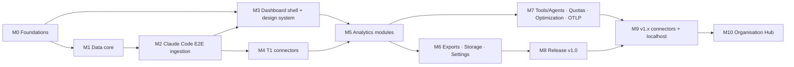

# Phase 5 — Implementation Roadmap

**How the roadmap works:**
- Each milestone ends in a **verifiable working deliverable**, with green CI and its acceptance criteria demonstrated.
- No milestone begins until the previous one's acceptance criteria pass.
- Sizes are relative: S ≈ 1 focused week, M ≈ 2 weeks, L ≈ 3–4 weeks. They are effort indicators, not calendar commitments.

## M0 — Foundations (M)

> **Implementation notes (2026-11-08).** Deviations from the plan:
> - **Command catalogue.** The command list is a callback macro, `veyra_app::for_each_command!`, rather than an `api_commands!` macro (ADR-010).
> - **Git hooks.** Plain `.githooks/` scripts with no dependency, instead of lefthook.
> - **WebKitGTK/WKWebView render spike (task 9).** Moved to M3, where Tailwind and ECharts are introduced. CI logs the WebKitGTK version on Ubuntu 22.04.
> - **TypeScript drift test.** Covered by `pnpm contracts:check` rather than a separate test project.

**Goal.** An empty but production-shaped repository, with a secure Tauri window that loads a page and calls one typed command.

**Tasks.**

*Toolchain and repository*
1. Install `rustup` (stable) and the Visual Studio Build Tools C++ workload. Enable Corepack and pnpm.
2. `git init`, `.gitignore`, `.editorconfig`, licence files (after D2), `README`, `CONTRIBUTING`, `SECURITY`, `CODE_OF_CONDUCT`.
3. pnpm workspace (`apps/desktop`, `packages/contracts`) and Cargo workspace (`crates/*`, `src-tauri`). Pin `rust-toolchain.toml` and `.npmrc` (`minimumReleaseAge`, `ignore-scripts` plus an allow-list).

*Shell and contracts*
4. Tauri 2 shell:
   - `main` window only;
   - capabilities restricted;
   - strict CSP;
   - no shell or SQL plugin;
   - `AppManifest` command allow-list.
5. Contracts pipeline: ts-rs export, the `api_commands!` macro, and a generated `commands.ts`. One `get_app_info` command round-trips with types.

*Quality gates*
6. Lint and format: ESLint flat config (strict-type-checked plus boundary rules), Prettier, rustfmt, clippy, git hooks.
7. CI (`ci.yml`, `security.yml`) on Windows, macOS and Ubuntu 22.04, with actions pinned by SHA and minimal permissions.

*Records and spikes*
8. Write ADR-001 to ADR-018 as files.
9. Spike: WebKitGTK and WKWebView render check of Tailwind 4 tokens (OKLCH, `color-mix`) and an ECharts canvas sample.

**Acceptance criteria.**
- `pnpm tauri dev` opens the window on Windows; CI builds and tests pass on all three OSes.
- The generated contract is consumed by TS; the drift check fails CI when the contract is edited by hand.
- cargo-deny (licences, advisories, bans) and `pnpm audit` pass.
- The capability file grants only the declared commands. A test calls an undeclared command and it is rejected.

**Tests.** Contract round-trip test; capability denial test; lint rules for module boundaries, with a fixture violation in a test project.

## M1 — Data core (L)

> **Implementation notes (2026-11-08).** Delivered as `veyra-domain`, `veyra-registry`, `veyra-analytics`, `veyra-store` and `tools/perf`, with these refinements (ADR-022):
> - **Migrations:** our own migration runner replaces `rusqlite_migration`, which is incompatible with the pinned rusqlite.
> - **Field names:** the cache-write fields are named short/long TTL.
> - **Rollups:** three clustered rollup levels (totals, per dimension, full), rebuilt set-based.
> - **Property tests:** written with a seeded in-repo generator instead of `proptest`.
> - **Compile-fail test:** a `compile_fail,E0308` doctest instead of a separate test crate.
> - **Prices:** the catalogue was verified row by row on the official pages on 2026-11-08.
> - **Performance:** budgets met at 1M events (overview query p95 51–81 ms) when measured with free memory; the `Performance` CI workflow re-checks on a clean runner.

**Goal.** Domain, store, pricing and metric engines, fully tested, with no UI or connectors.

**Tasks.**

*Domain*
1. `veyra-domain`:
   - identities, `UsageEvent`, `TokenCounts` invariants;
   - `Accuracy` and propagation;
   - `Money` and the three cost kinds;
   - ports.
2. `veyra-registry`: TOML schema and loaders. Seed providers, apps, models and tool categories.

*Pricing*
3. Pricing catalogue v1: **row-by-row verification** of Anthropic, OpenAI and Google current and recent models against the official pages, with `source_url` and `verified_at`. Historical rows for price changes are documented where verifiable.
4. Pricing engine: rule resolution, tiers, modifiers, integer math, statuses, `CostBreakdown`.

*Store and metrics*
5. `veyra-store`:
   - WAL setup, the writer actor and the reader pool;
   - migrations v1;
   - repositories;
   - incremental `rollup_15m` and `session_stats` maintenance;
   - `VACUUM INTO` backup.
6. Metric registry and engine: base sums → derived metrics; comparisons; top-N with an exact "Other".
7. Synthetic event generator (`tools/perf`) for 1M and 10M events.

**Acceptance criteria.**
- Every metric in PRD §7 has a calculation test with hand-computed expected values.
- **Pricing:**
  - tier boundaries;
  - effective-date boundaries (an event exactly at the change instant);
  - unpriced, partial and stale statuses;
  - rounding;
  - the "cannot add cost kinds" rule as a compile-fail test.
- **Store:**
  - upserting the same batch twice changes nothing;
  - rollup totals equal raw-event totals for random datasets (property test);
  - migrations upgrade from an empty and from a seeded database.
- **Performance:** the overview query runs on the 1M dataset within the budget.

## M2 — Claude Code end-to-end ingestion (L)

> **Implementation notes (2026-11-08).** Delivered as `veyra-connectors`, `veyra-ingest`, migration 0002 and three source commands (ADR-023).
> - **Spike:** results are in [`docs/connectors/claude-code.md`](../connectors/claude-code.md). Order-independent precedence replaces "last write wins".
> - **Golden tests:** expressed as field-level assertions per request on the fixtures, which fail with clearer messages than byte-for-byte golden files.
> - **Safety:** canary fixtures, plus a real-data check in which the source logs contain canaries and the database holds none. A share-mode test renames and deletes a file while it is open. A concurrent writer appends half-lines during scans.
> - **Throughput (budget amended 2026-11-08):**
>   - End to end, ingestion runs at about 50,000–60,000 events/s on the build machine, from overlapped parsing and committing, and at 39,000–49,000 events/s per attempt on GitHub-hosted runners (best of three: 41,400–48,900).
>   - The CI budget is therefore **≥ 35,000 events/s, best of three runs**: about 15% below the slowest best-of-three result measured (41,400 events/s), matching the runner-to-runner variance of up to 20%, so a failure signals a real regression rather than slow hardware. A 40,000 budget was tried first and cleared the slowest runner by only 3.5%. The original ≥ 50k target holds on developer hardware only.
>   - Real backfill: 1.3 GB of logs in 8.9 s, dominated by reading the logs rather than the store; rescans take 0.2 s.
>   - Store write-path tuning: migration 0003, and statements prepared once per batch.
> - **Deferred:** process-priority lowering and jittered backoff were not needed to meet the budgets. Failures are recorded per source, and the periodic scan retries.
> - **Consent UI:** consent is exercised through the `set_source_enabled` command; the Sources page arrives in M3.

**Goal.** Real Claude Code history ingested continuously, correctly and safely.

**Tasks.**
1. **Validation spike on this machine (real files, read-only, results stay local):**
   - confirm the JSONL fields;
   - confirm the duplicate-streaming pattern;
   - confirm the subagent layout;
   - confirm where the VS Code extension and Desktop Code tab write;
   - record the tool versions.

   Turn the findings into **synthetic** fixtures. Real transcripts never enter the repository.
2. `SourceConnector` framework:
   - discovery (env location overrides only);
   - `SourceFs` with root scoping and a credential-file deny-list;
   - Windows share-mode reads;
   - checkpoints with byte offset and head fingerprint, plus truncation and rotation handling.
3. Claude Code connector: parse, deduplicate (`requestId` / `message.id`), subagent links, tool-call summaries, cwd → project.
4. Normaliser: canonical tokens, attribution via the registry, invariants, deduplication keys.
5. Ingest pipeline:
   - scheduler with triggers (startup, watcher, periodic, manual);
   - cancellation;
   - backoff;
   - below-normal priority;
   - batched transactions with checkpoints;
   - `data.changed` events;
   - diagnostics tables.
6. Consent model: sources stay disabled until the user consents (exercised through a minimal command until the M3 UI exists).
7. `docs/connectors/claude-code.md`.

**Acceptance criteria.**
- **Ingestion correctness:**
  - Golden tests: fixtures → expected normalised events, byte for byte.
  - Idempotency: a full re-ingest produces 0 changed rows.
  - Truncation, rotation and deletion of a source file are handled; no double counting on resumed sessions.
- **Safety:**
  - A canary-string fixture confirms that no prompt or response text reaches the database or logs.
  - While Veyra ingests, a test writer process appends to and rotates JSONL files on Windows with no sharing violations (AC-7 foundation).
- **Throughput:** backfill reaches ≥ 50k events/s on developer hardware (≥ 35k on GitHub-hosted CI runners; see the implementation notes), with idle CPU ≈ 0% after backfill.
- **Retention:** totals are unchanged after the source files are deleted.

## M3 — Dashboard shell and design system (L)

> **Implementation notes (2026-11-09).** Delivered as the dashboard in `apps/desktop/src` and the commands `get_overview`, `list_sessions` and `get_session` (ADR-024).
> - **Contract test:** the Overview equals the metric engine for the same specification, its parts add up to the headline, and sessions sum to the Overview total. Every page names a model the same way.
> - **Single sources:** KPI definitions come from the metric registry; provider, model and application names from the registry and connector descriptors (`Labelled`). Empty periods show "—", never 0.
> - **Palette:** validated by `tooling/palette/check-palette.js` inside `pnpm test` (contrast, CIEDE2000 separation and colour-blind simulation).
> - **UI tests:** Playwright with axe on the synthetic fixture client, in a new `UI` CI job. They cover the first-run consent flow (UC-01), the keyboard-only session journey (UC-02), filter state with Back and Forward, and WCAG 2.2 A/AA checks of every page in both themes. A second project runs the production build under the production CSP; it found and drove fixes for blocked tooltip markers, an inlined font and injected scroll-lock styles, with the policy unchanged (ADR-024).
> - **IPC:** the window may listen to application events (`core:event:allow-listen` and `allow-unlisten` only); emitting stays denied.
> - **Deferred:**
>   - Scatter and Waterfall primitives and Overview highlights move to M5 (Cost and Cache pages).
>   - The interface filter control waits for a second interface (M4).
>   - TanStack Table and Virtual are not needed while the core pages sessions (ADR-024).
>   - The WebdriverIO smoke test on real bundles and the WebKitGTK visual check move to M8, with the release pipeline.
>   - The moderated usability test is a manual step before the internal alpha.

**Goal.** The product frame and three real pages on M2 data.

**Tasks.**

*Frame and shared building blocks*
1. Tokens in `tokens.css`; light and dark themes; Inter and JetBrains Mono bundled; palette validation script in CI.
2. App shell: grouped sidebar, header status cluster, command palette, keyboard shortcuts, error boundary.
3. Global filter model: URL codec, query bar, Filters panel, chips, period stepping, comparison.
4. `shared/api`: transport, client and Query integration with `data.changed` invalidation.
5. `shared/charts`: ECharts runtime (tree-shaken), a theme generated from the CSS variables, and primitives (Trend, StackedTrend, Ranking, Composition, Calendar, Heatmap, Treemap, Scatter, Waterfall). Every primitive has a table twin and escaped tooltips.
6. `shared/data-table`, `shared/metrics` (KpiTile, DeltaChip, Sparkline), `shared/accuracy` (badge, coverage meter), `shared/format`.

*First pages*
7. Pages: **Overview**, **Sessions** (explorer and detail with timeline), **Sources & Health**, including the first-run consent flow.

**Acceptance criteria.**
- Overview numbers equal the M1 metric-engine outputs for the same specification (contract test).
- Filter changes update all cards; back and forward restore state.
- axe passes in both themes; the keyboard-only journey works for UC-02.
- Playwright UI tests run with IPC fixtures; one WebdriverIO smoke test passes on the real bundle on all three OSes.
- Linux (WebKitGTK) visual check passes for all chart primitives.

## M4 — Remaining Tier-1 connectors (M–L)

> **Implementation notes (2026-11-10).** Delivered as the `codex`, `gemini_cli`, `opencode` and `copilot_cli` connectors, whole-file and database reading in the pipeline, and a capability matrix per source (ADR-025).
> - **Validation:** the development machine had only the Codex desktop app (no sessions yet) and Copilot debug logs, so each format was verified against the tool's source code or published schema at a recorded commit. The Codex desktop app's thread index points at the same rollout files as the CLI, which settles the open question from the research. Details are in `docs/connectors/`.
> - **Codex:** exact per-response records where the version writes them, otherwise increases of running totals. Resets start a new baseline and fork copies are excluded. The test checks that the counted increases add up to the final total. `rate_limits` are not read yet (planned with quotas, M7).
> - **Gemini CLI:** last copy of each message, both the JSONL and the older JSON document formats, and the project folder from `.project_root`. Background requests are not recorded by the tool; the capability matrix says so.
> - **OpenCode:** read through a snapshot of the live database (ADR-015). Both table generations are read, with each message counted once. The test shows OpenCode writing continuously with no busy timeout while Veyra reads. Sessions stored as JSON before 1.2 are not read.
> - **Copilot CLI:** the spike confirmed the aggregation rule (per run before 1.0.66, cumulative from 1.0.66), so it ships at session granularity with provider-reported accuracy rather than being deferred. Per-request usage is never written to disk by Copilot.
> - **Attribution:** gateways are recorded separately from vendors, and the registry resolves gateway spellings of model names. A test checks Claude through Copilot as provider Anthropic, gateway GitHub Copilot, application Copilot CLI.

**Tasks.**
1. Run a validation spike per connector, as in M2 (real files read locally, synthetic fixtures committed).
2. Connectors:
   - **Codex CLI:** cumulative deltas, resets, `.jsonl.zst` with caps, `rate_limits` captured for M7;
   - **Gemini CLI:** latest per message id, `thoughts` and `tool` semantics;
   - **OpenCode:** SQLite snapshot through the backup API;
   - **Copilot CLI:** if the spike confirms the aggregation rule; otherwise defer and document why.
3. Cross-source attribution tests: Claude via Copilot, for example, attributes provider Anthropic, gateway Copilot and application Copilot CLI.
4. Connector documentation pages and capability matrices.

**Acceptance criteria.**
- Golden and idempotency tests for each connector.
- Codex: the sum of deltas equals the final cumulative counter per session, and resets are handled.
- OpenCode: the live database is never locked (a test writer runs concurrently).
- Sources & Health shows the accurate capability matrix and freshness for every connector.

## M5 — Analytics modules (L)

**Tasks.**
1. Pages: Usage, Cost, Cache, Models & Providers, Projects with project detail, Activity.
2. Cost features:
   - billing entries (manual subscriptions and charges);
   - budgets, run rate and forecast;
   - the assumptions panel;
   - the waterfall of period change.
3. Project management: rename, merge, alias.
4. Highlights on Overview: deterministic insight chips.

**Acceptance criteria.**
- Every card's numbers are verified against metric-engine tests (view-model unit tests plus contract tests).
- No UI path sums cost kinds (AC-5), verified by a test over every DTO.
- Cache savings show only where the rates are complete; partial coverage is displayed.
- Performance budgets are met on 1M and 10M datasets for every page's queries.

## M6 — Exports, Storage, Settings, privacy controls (M)

**Tasks.**
1. Export engine: CSV, JSON and XLSX (after crate admission review), presets, redaction options, the native save dialog, audit log entries.
2. Storage page: sizes, growth, backups with restore preview, retention policy with preview, delete Veyra data by scope.
3. Settings: time zone, week start, locale, titles policy, pricing overrides and custom models, stale threshold, start at login, background mode, density.
4. Log redaction layer; diagnostic bundle export, reviewed by the user.

**Acceptance criteria.**
- Export totals equal the on-screen totals for the same filters.
- Redaction is verified: hashed names, no paths or titles when off.
- Restore of a backup round-trips.
- Retention pruning leaves totals unchanged.

## M7 — Tools & Agents, Quotas, Optimization, OTLP receiver (L)

**Tasks.**
1. Tools & Agents page: categories, MCP servers and tools, subagent share, the scatter chart, error signals.
2. Quotas:
   - `QuotaObserver` framework;
   - **Claude statusline forwarder** (a documented snippet the user installs; a local endpoint or file drop; verification);
   - Codex `rate_limits`;
   - burn rate and projection;
   - "observed at" provenance.
3. Optimization rules v1 with overlap-aware impact, evidence, confidence and configurable thresholds.
4. Opt-in local **OTLP receiver** (HTTP/protobuf and JSON on 127.0.0.1) for Claude Code, Codex, Gemini CLI and Copilot VS Code. Shared deduplication keys with the file connectors. A primary-source policy per application.

**Acceptance criteria.**
- With JSONL and OTel both enabled for Claude Code, totals are unchanged (no double counting).
- Quota cards always show the observation time; no stale observation is shown as live.
- Each rule has fixture datasets proving it fires, stays silent and computes the stated impact; overlap is not double counted.
- With the receiver disabled (the default), no ports are open.

## M8 — Release engineering and v1.0 (M)

**Tasks.**
1. Release workflow: installers per OS (NSIS/MSI, DMG/app, AppImage/deb/rpm), SHA-256 checksums (signed), CycloneDX SBOMs, provenance attestations, draft release.
2. Opt-in updater: signing key ceremony (offline backup, documented rotation) and `latest.json` on Releases.
3. User documentation: install, including the unsigned-binary steps per OS; privacy; troubleshooting; connector pages.
4. Fuzz tests for each connector parser. Final security review against the threat model. Apply to SignPath (if D2 is OSI).
5. Full acceptance run of AC-1 to AC-10.

**Acceptance criteria.**
- Clean-machine installs succeed on Windows 11, macOS (Apple Silicon) and Ubuntu 22.04.
- Default settings produce **zero** outbound connections (AC-8).
- Checksums verify; the SBOM is attached; the release notes list the connectors and their accuracy.

## M9 — v1.x extensions (L, incremental)

- Connectors: Claude Desktop Chat/Cowork, Aider, Cline/Roo. Each ships with a spike, fixtures and documentation.
- Billing connectors: OpenRouter activity, OpenAI and Anthropic admin usage/cost, xAI. User-supplied keys go in the OS keyring, with an explicit network-permission prompt per connector.
- Localhost browser access: `HttpTransport`, a token, Host/Origin checks, off by default.
- Saved views and advanced forecasting.

## M10 — Organisation Hub (L)

- `veyra-hub` binary and container image.
- Pairing (Ed25519) and signed idempotent batches.
- A policy engine and the employee sharing preview.
- RBAC, the audit log and per-org isolation.
- The Hub dashboard through the shared app with `HttpTransport`.
- Self-hosting documentation (reverse proxy and TLS).

**Acceptance criteria.**
- A revoked device's uploads are rejected.
- The sync payload schema contains no content fields (schema test).
- Isolation tests show no cross-organisation data leakage.
- The device works fully while the Hub is offline.

## Release milestones

| Release | Contents |
|---|---|
| **0.1 (internal alpha)** | M0–M3: Claude Code only; Overview, Sessions, Sources |
| **0.5 (public beta)** | + M4–M6: all Tier-1 connectors and analytics modules; exports |
| **1.0** | + M7–M8: Tools & Agents, Quotas, Optimization, OTLP receiver; installers, updater, documentation |
| **1.x** | M9 extensions |
| **2.0** | M10 Organisation Hub |

## Testing strategy summary (applies across milestones)

| Level | Scope | Tooling |
|---|---|---|
| Unit | Domain invariants, pricing, metrics, normaliser, rules, view models, formatters | `cargo test`, proptest†, Vitest |
| Parser / golden | Each connector × format version: fixtures → expected normalised events | `cargo test` + snapshot files (insta†) |
| Integration | Pipeline into real SQLite in a temp dir; idempotency; deduplication; truncation and rotation; concurrent writers | `cargo test` |
| Migration | Upgrade from every released schema version with seeded data | `cargo test` |
| Security | Capability denial; canary-content leak test; credential deny-list; CSP; fuzzing | `cargo test`, cargo-fuzz†, Playwright |
| UI | Components and pages with IPC fixtures; axe accessibility; both themes | Vitest + Testing Library, Playwright |
| E2E (bundle) | Smoke on real builds, all three OSes | WebdriverIO + `@wdio/tauri-service` |
| Performance | 1M / 10M datasets; query and ingest budgets; memory | Nightly `perf.yml` |
| Installation | Clean-VM install and uninstall per OS before each release | Release checklist |

† Candidate dependency; admitted through the §12.3 checklist in [02-architecture.md](02-architecture.md).

**Fixture policy.** Only synthetic data is committed. Real files are used only for local validation spikes, which never leave this machine and never reach the repository.

## Immediately after approval

1. Record your answers to D1–D5 ([README](README.md#decisions-approved-2026-11-08-all-recommendations-accepted)).
2. Start M0, step 1: the toolchain installs (Rust and MSVC Build Tools). These are system-level installs, so I will ask before running them.
