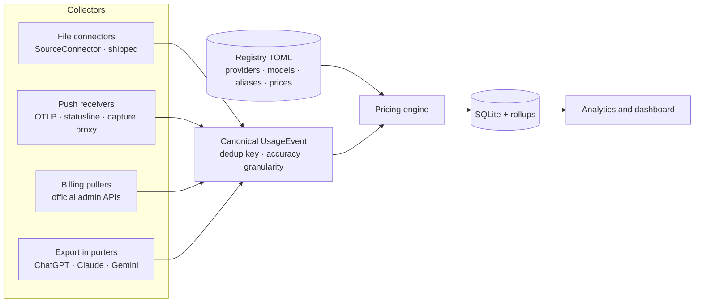

# Universal coverage: what Veyra can track, and how

**Prepared:** 2026-11-19
**Question:** can Veyra become a free, local-first, privacy-first monitor for AI usage across every provider (Anthropic, OpenAI, Google, xAI and future ones) and every surface (apps, APIs, agents)?

**Short answer:** yes for everything that runs on the user's machine or bills through an API key. No for consumer chat apps. Their web and mobile clients do not expose token usage anywhere Veyra may read it. They can be covered only partly, through the official data exports, with estimated tokens. Veyra's architecture already fits this. What is missing are three collector kinds and some registry data, not a redesign.

This document builds on the source-coverage matrix ([00-research.md §0.3](00-research.md)) and the feasibility table ([04-feasibility-risks.md §1](04-feasibility-risks.md)). It does not repeat them.

## 1. Platform limits

| Limit | Consequence |
|---|---|
| Consumer chat apps keep usage on the provider's servers: ChatGPT web, desktop and mobile; Claude.ai; the Gemini app; Grok. None of them publishes per-message token counts. | No exact token tracking is possible for these surfaces. |
| Reading other apps' cookies or OAuth tokens, or calling private endpoints, is excluded (D1, ADR-014). | No live subscription quota for ChatGPT, Gemini or Grok. Claude quota only through the statusline feed. |
| Mobile apps are sandboxed. | Nothing on a phone is observable. Exports cover phone usage only after the fact. |
| Network interception of HTTPS traffic would need a trusted root certificate. | Rejected. It is a security risk and breaks certificate pinning. The capture proxy (§3.2) works only because the user points a client at it. |
| Provider tokenizers: OpenAI's is public; Anthropic's and Google's are only available as online counting APIs. | Offline token estimates for chat exports are approximate and labelled Estimated. |

## 2. Coverage by surface

**Automatic** means no user action beyond enabling a source. **Integration** means the user turns something on once: an environment variable, a base URL or an API key.

| Provider | Surface | How | Accuracy | Status |
|---|---|---|---|---|
| Anthropic | Claude Code (CLI, Desktop Code tab, IDE) | Local JSONL | Exact | **Automatic, shipped** |
| Anthropic | Claude Code via OTel, statusline quota | OTLP receiver, statusline forwarder | Exact; quota observed | Integration (M7) |
| Anthropic | Claude API | Capture proxy (§3.2) or Admin usage/cost API | Exact / Provider-reported | Integration |
| Anthropic | Claude.ai web, desktop chat, mobile | Official data export (§3.3) | Messages exact; tokens Estimated | Integration (import) |
| OpenAI | Codex CLI | Local JSONL | Exact | **Automatic, shipped** |
| OpenAI | OpenAI API (any model, including future ones) | Capture proxy or organisation usage/costs API | Exact / Provider-reported | Integration |
| OpenAI | ChatGPT (all models and plans) | Official data export | Messages and model per message; tokens Estimated | Integration (import) |
| Google | Gemini CLI | Local JSONL | Exact | **Automatic, shipped** |
| Google | Gemini API | Capture proxy | Exact | Integration |
| Google | Gemini app | Google Takeout (Gemini Apps activity) | Prompts only; tokens Estimated; model often absent | Integration (import, Partial) |
| xAI | xAI API | Capture proxy (OpenAI-compatible) or Management API billing | Exact / Provider-reported | Integration |
| xAI | Grok app | Data export **UNVERIFIED** | At best Estimated | To verify |
| Any | OpenCode, Copilot CLI | Local SQLite / JSONL | Exact / Partial | **Automatic, shipped** |
| Any | Tools emitting OTel GenAI spans (Copilot in VS Code, agent frameworks) | OTLP receiver | Exact where emitted | Integration (M7) |
| Any | Ollama, LM Studio, OpenRouter, Groq, DeepSeek, Mistral, Together and any OpenAI-compatible endpoint | Capture proxy; OpenRouter also through its activity API | Exact | Integration |
| — | Windsurf, Antigravity, Zed, Cursor (exact), live chat-app quotas | No local data and no official per-user channel | — | **Not reliably capturable**: shown as Unsupported with the reason |

## 3. Architecture

All collectors produce the same canonical `UsageEvent`. Everything downstream stays exactly as it is: deduplication, pricing, the 15-minute rollups and analytics. That pipeline is provider-agnostic already.

### 3.1 What already makes it provider-agnostic

- **Registry as the single source of truth.** Providers, models, aliases and effective-dated prices live in TOML. A new model, or a new name for one, is a data change. An unknown model is still stored and counted, and shown as unpriced. Nothing is dropped.
- **Canonical event.** It has the fields that matter for every provider:
  - an accuracy class on every metric;
  - `Granularity::Request | Bucket`, so billing API aggregates never mix with request events;
  - a dedup key, so two collectors seeing the same request count it once (architecture §6.4).
- **Collector contract.** `SourceConnector` is the extension point for files. The three new kinds below follow the same pattern: one trait per kind, one small adapter per tool. Adding a tool never touches pricing, storage or analytics.

### 3.2 Collectors to add, in order of coverage per unit of work

1. **OTLP receiver** (planned in M7).
   - Covers Claude Code, Codex, Gemini CLI and Copilot in VS Code, plus anything else that emits the OTel GenAI semantic conventions.
   - One mapping from `gen_ai.*` attributes covers future tools at no extra cost.
   - Listens on 127.0.0.1 only and is off by default.
2. **Local capture proxy** (Tier 5 in the feasibility plan; this brings it forward).
   - The user sets their client's base URL to `http://127.0.0.1:<port>/<provider>`. Veyra forwards over HTTPS, unchanged, and reads only the `usage` block, the model and the request id from each response.
   - Covers every API that speaks the OpenAI, Anthropic or Gemini wire shape, which is nearly all of them, xAI and local runtimes included. A new provider is a registry entry plus, at most, a new upstream URL.
   - **Rules:**
     - API keys pass through in headers and are never stored or logged.
     - Request and response bodies are never stored.
     - Streaming responses are relayed as they arrive, and usage is read from the final chunk. Where a client does not ask for streamed usage, the event is marked Partial.
3. **Billing pullers** (M9): Anthropic and OpenAI admin APIs, OpenRouter activity, xAI Management API.
   - Bucket-granularity events.
   - User keys are kept in the OS keyring, behind a network-permission prompt per connector.
   - A secondary source per application, so they reconcile cost and never add tokens twice.
4. **Export importers** (new). These are the only route to ChatGPT, Claude.ai and Gemini app usage.
   - The user picks the official export archive. Veyra reads each message transiently to get the timestamp, model, role and length, and stores only counts.
   - Tokens are estimated:
     - with OpenAI's public tokenizer for ChatGPT;
     - with a documented characters-per-token ratio for the others.
   - Events are marked Estimated, with a dedup key from the conversation and message ids, so re-importing a newer export adds only new messages.
   - No prompt text is ever stored, as NFR-03 requires.

### 3.3 Why not a browser extension or traffic sniffing

- A browser extension could observe chat pages live. But the pages do not carry token counts, their DOM and network formats change without notice, and an extension needs broad page access. That is high maintenance for estimated data the export importer already provides.
- System-wide interception was rejected in §1.

## 4. Gaps found in the codebase

| Gap | Fix | Size |
|---|---|---|
| The registry has no xAI provider or Grok models. | Add `xai` to `providers.toml` with models, aliases and source-cited prices. | Data only |
| ChatGPT and Gemini app model names are not in the registry. | Add them as models without API prices. Their events remain unpriced, which is correct for subscription usage. | Data only |
| No push-receiver or importer trait. | Add one trait per kind next to `SourceConnector`, when the first adapter of that kind lands. | Small |
| No tokenizer data for estimates. | Bundle OpenAI's public encoding for the importer only. Other providers use a documented ratio. | Small |

## 5. Recommended sequence

1. Registry data for xAI and the chat-app models (prices verified against official pages).
2. OTLP receiver: the largest exact coverage for one component.
3. Capture proxy: every API provider, current and future.
4. Export importers: ChatGPT first (best export: model per message), then Claude.ai, then Gemini.
5. Billing pullers.

Each step is independent and adds sources without changing existing behaviour.

## 6. Resource and cost budget

- **Cost:** none. Every channel is local or an official API the user already has. Nothing is hosted by Veyra.
- **Idle cost:** none. The receiver and the proxy are off by default and open no ports until enabled.
- **Load when enabled:** each holds one listener. The proxy adds a single local hop.
- **Importers** run once per archive, in a streaming parse with bounded memory.
